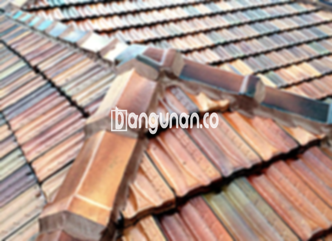

**Jual Genteng Kermaik & Beton di Kelapa Gading Jakarta** – Genteng adalah material hunian yang sangat penting untuk dimiliki setiap pemilik rumah. Genteng akan melindungi hunian Anda dari berbagai kondisi cuaca seperti hujan, panas terik matahari, dan lain sebagainya. Dengan memilih genteng yang tepat, Anda akan menciptakan suasana hunian yang lebih nyaman dan aman. Mitra Bangunan hadir di Kelapa Gading Jakarta untuk membantu Anda menemukan genteng berkualitas terbaik untuk rumah impian Anda.

Memilih jenis genteng yang sesuai dengan kebutuhan dan anggaran Anda adalah langkah penting dalam pembangunan atau renovasi rumah. Ada banyak sekali ragam genteng yang tersedia di pasaran, masing-masing memiliki keunggulan dan kekurangan tersendiri. Kami di Kelapa Gading Jakarta memahami bahwa setiap orang memiliki preferensi yang berbeda, dan kami berkomitmen untuk menyediakan berbagai pilihan genteng yang dapat memenuhi semua kebutuhan Anda.



## Harga Genteng Dari Toko Jual Genteng Kermaik & Beton di Kelapa Gading Jakarta

Kami menawarkan berbagai macam genteng dengan harga yang kompetitif. Berikut adalah informasi mengenai harga beberapa jenis genteng yang tersedia di toko kami di Kelapa Gading Jakarta:

### - Harga Genteng Metal Di Toko Genteng Kermaik & Beton di Kelapa Gading Jakarta

Genteng metal merupakan pilihan populer karena ringan, kuat, dan tahan lama. Banyak pemilik rumah di Kelapa Gading Jakarta memilih genteng metal untuk bangunan mereka karena kemudahan pemasangannya dan desainnya yang modern. Informasi detail mengenai harga genteng metal tersedia di tabel harga kami.

### - Harga Genteng Aspal Di Toko Genteng Kermaik & Beton di Kelapa Gading Jakarta

Genteng aspal memberikan tampilan yang elegan dan mewah pada atap rumah Anda. Terbuat dari serat kayu dan aspal berkualitas tinggi, genteng ini tahan terhadap api dan memiliki kemampuan meredam suara yang baik. Untuk mengetahui harga terbaru genteng aspal, Anda bisa melihat tabel harga atau menghubungi tim kami.

### - Harga Genteng Keramik & Beton di Kelapa Gading Jakarta

Genteng keramik dan beton adalah pilihan yang umum digunakan di Kelapa Gading Jakarta karena daya tahan dan ketersediaan warnanya yang beragam. Keduanya adalah investasi jangka panjang yang akan melindungi rumah Anda selama bertahun-tahun. Detail harga genteng keramik dan beton dapat Anda temukan di tabel harga.

### - Harga Genteng Kaca Di Toko Genteng Kermaik & Beton di Kelapa Gading Jakarta

Genteng kaca sering digunakan sebagai aksen untuk menciptakan pencahayaan alami di dalam rumah. Namun, perlu diingat bahwa penggunaan genteng kaca yang berlebihan dapat menyebabkan ruangan menjadi lebih panas. Informasi mengenai harga genteng kaca tersedia di tabel harga kami.

### - Harga Genteng Seng Di Toko Genteng Kermaik & Beton di Kelapa Gading Jakarta

Genteng seng adalah pilihan ekonomis yang sering digunakan untuk bangunan sederhana. Meskipun ringan, genteng seng perlu dipasang dengan hati-hati agar tidak mudah berkarat atau bocor. Anda dapat melihat harga terbaru genteng seng di tabel harga.

### - Harga Genteng Beton Di Toko Genteng Kermaik & Beton di Kelapa Gading Jakarta

Genteng beton dikenal karena kekuatannya dan kemampuannya menahan cuaca ekstrem. Terbuat dari campuran semen, pasir, dan air berkualitas tinggi, genteng beton adalah pilihan yang tepat untuk rumah Anda di Kelapa Gading Jakarta. Informasi harga genteng beton yang terkini dapat Anda lihat di tabel harga.



## Beberapa Macam Genteng Dari Toko Jual Genteng Kermaik & Beton di Kelapa Gading Jakarta

Berikut ini adalah beberapa jenis genteng yang tersedia di toko kami, yang dapat Anda pertimbangkan untuk membangun atau merenovasi rumah Anda di Kelapa Gading Jakarta:

### Genteng Keramik Dari Toko Jual Genteng Kermaik & Beton di Kelapa Gading Jakarta

Genteng keramik adalah pilihan yang sangat populer karena keindahan dan daya tahannya. Anda akan menemukan berbagai desain dan warna yang dapat mempercantik tampilan rumah Anda. Selain itu, genteng keramik dapat membantu menjaga rumah tetap sejuk dengan memantulkan panas matahari.

### Genteng Seng dan Genteng Kermaik & Beton di Kelapa Gading Jakarta

Genteng seng adalah pilihan ekonomis yang cocok untuk bangunan dengan anggaran terbatas. Ukurannya yang panjang memudahkan pemasangan dan menghemat biaya. Penting untuk memastikan genteng seng dipasang dengan benar agar tahan lama.

### Genteng Asbes dan Genteng Kermaik & Beton di Kelapa Gading Jakarta

Genteng asbes, meskipun dahulu banyak digunakan, kini kurang direkomendasikan karena dampak negatifnya terhadap kesehatan. Kami menyarankan untuk mempertimbangkan alternatif material yang lebih aman dan ramah lingkungan.

### Genteng Kanopi Baja Ringan dan Genteng Kermaik & Beton di Kelapa Gading Jakarta

Genteng kanopi baja ringan adalah pilihan modern yang ringan, kuat, dan mudah dipasang. Desainnya yang fleksibel memungkinkan Anda menciptakan berbagai bentuk atap yang menarik.

### Genteng Sirap Kayu Ulin dan Genteng Kermaik & Beton di Kelapa Gading Jakarta

Genteng sirap kayu ulin memberikan tampilan alami dan tradisional pada rumah Anda. Kayu ulin yang berkualitas tinggi menjamin kekuatan dan ketahanan genteng ini terhadap cuaca yang keras.

Anda dapat memilih berbagai jenis Genteng Kermaik & Beton di Kelapa Gading Jakarta yang paling sesuai dengan kebutuhan dan selera Anda. Hubungi kami untuk mendapatkan informasi lebih lanjut dan penawaran harga terbaik. Mitra Bangunan siap membantu Anda mewujudkan atap rumah impian Anda di Kelapa Gading Jakarta. [Jual Genteng Kermaik & Beton di Ancol Jakarta](/jual-genteng-kermaik-beton-di-ancol-jakarta/) juga dapat memberikan inspirasi tambahan.

**Ref by:**  [Genteng Kermaik & Beton  Kelapa Gading Jakarta](https://id.wikipedia.org/wiki/Genteng)