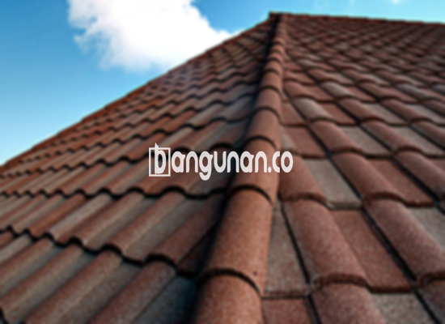

**Jual Genteng Kermaik & Beton di Kelapa Nunggal** – Genteng adalah sebuah material konstruksi yang sangat penting untuk setiap hunian. Mitra Bangunan di Kelapa Nunggal hadir untuk menyediakan genteng berkualitas yang akan melindungi rumah Anda dari berbagai kondisi cuaca, seperti hujan deras dan terik matahari. Dengan memilih genteng yang tepat, Anda tidak hanya meningkatkan keamanan hunian, tetapi juga memperindah tampilannya.

Mencari genteng yang sesuai adalah investasi jangka panjang. Ada beragam jenis genteng dengan kelebihan dan kekurangannya masing-masing. Mempertimbangkan kebutuhan dan gaya arsitektur rumah Anda akan membantu Anda membuat keputusan yang paling tepat. Kami memahami betul pentingnya memilih material bangunan yang tahan lama dan sesuai dengan anggaran Anda di Kelapa Nunggal.



## Harga Genteng dari Toko Jual Genteng Kermaik & Beton di Kelapa Nunggal

Untuk membantu Anda dalam merencanakan anggaran proyek bangunan, kami menyediakan berbagai jenis genteng dengan harga yang kompetitif. Berikut ini adalah gambaran harga beberapa jenis genteng yang tersedia di toko kami yang berlokasi di Kelapa Nunggal:

### - Harga Genteng Metal di Toko Genteng Kermaik & Beton di Kelapa Nunggal

Genteng metal adalah pilihan yang populer karena kekuatannya dan desainnya yang modern. Material ini sangat cocok untuk rumah-rumah bergaya minimalis dan modern di area Kelapa Nunggal. Untuk mengetahui harga terbaru, silakan merujuk pada tabel harga yang tersedia di bawah ini.

### - Harga Genteng Aspal di Toko Genteng Kermaik & Beton di Kelapa Nunggal

Genteng aspal menawarkan tampilan yang elegan dan daya tahan yang baik. Terbuat dari serat kayu dan aspal berkualitas tinggi, genteng ini memberikan perlindungan efektif terhadap cuaca ekstrem dan bahkan tahan terhadap api. Detail harga genteng aspal bisa Anda temukan pada daftar harga di bawah.

### - Harga Genteng Kermaik & Beton di Kelapa Nunggal

Genteng keramik dan beton merupakan pilihan klasik yang sangat diminati. Kombinasi antara kekuatan dan estetika yang ditawarkannya menjadikan kedua jenis genteng ini ideal untuk berbagai jenis bangunan di Kelapa Nunggal. Ragam warna dan desain yang tersedia akan memungkinkan Anda menciptakan tampilan atap yang unik dan menarik.

### - Harga Genteng Kaca di Toko Genteng Kermaik & Beton di Kelapa Nunggal

Genteng kaca biasanya digunakan sebagai aksen untuk memberikan sentuhan dekoratif dan pencahayaan alami pada ruangan. Meskipun tidak digunakan secara menyeluruh pada atap, genteng kaca dapat menambahkan kesan mewah dan elegan pada desain rumah Anda. Cek harga terbaru pada tabel yang tersedia.

### - Harga Genteng Seng di Toko Genteng Kermaik & Beton di Kelapa Nunggal

Genteng seng adalah pilihan ekonomis yang sering digunakan untuk bangunan dengan anggaran terbatas. Material ini ringan dan mudah dipasang, namun memerlukan perawatan berkala untuk mencegah karat dan kerusakan. Harganya tersedia pada daftar di bawah ini.

### - Harga Genteng Beton di Toko Genteng Kermaik & Beton di Kelapa Nunggal

Genteng beton menawarkan kekuatan dan daya tahan yang luar biasa. Terbuat dari campuran semen, pasir, dan air berkualitas tinggi, genteng beton cocok untuk bangunan yang membutuhkan perlindungan maksimal dari berbagai kondisi cuaca di Kelapa Nunggal. Detail harga dapat dilihat pada tabel di bawah.



## Berbagai Macam Ragam Genteng dari Toko Jual Genteng Kermaik & Beton di Kelapa Nunggal

Kami menawarkan berbagai pilihan genteng dengan berbagai material dan desain. Berikut adalah beberapa jenis genteng yang tersedia untuk memenuhi kebutuhan bangunan Anda di Kelapa Nunggal:

### Genteng Keramik dari Toko Jual Genteng Kermaik & Beton di Kelapa Nunggal

Genteng keramik adalah pilihan yang populer karena keindahan dan ketahanannya. Pilihan warna dan desain yang beragam memungkinkan Anda menemukan genteng yang sesuai dengan gaya arsitektur rumah Anda di Kelapa Nunggal. Anda akan mendapatkan hunian yang lebih nyaman dan terlindungi dengan genteng keramik.

### Genteng Seng dan Genteng Kermaik & Beton di Kelapa Nunggal

Genteng seng adalah pilihan ekonomis yang sering digunakan untuk bangunan sederhana. Ukurannya yang panjang dan pemasangannya yang mudah menjadikannya solusi yang praktis untuk proyek konstruksi dengan anggaran terbatas di Kelapa Nunggal.

### Genteng Asbes dan Genteng Kermaik & Beton di Kelapa Nunggal

Genteng asbes, meskipun masih tersedia, kurang direkomendasikan karena potensi risiko kesehatan dan lingkungan. Pertimbangkan alternatif yang lebih aman dan ramah lingkungan untuk bangunan Anda di Kelapa Nunggal.

### Genteng Kanopi Baja Ringan dan Genteng Kermaik & Beton di Kelapa Nunggal

Genteng kanopi baja ringan menawarkan kombinasi antara kekuatan, ringan, dan estetika modern. Material ini sangat cocok untuk berbagai jenis atap dan desain rumah, memberikan perlindungan maksimal dari cuaca ekstrem di Kelapa Nunggal.

### Genteng Sirap Kayu Ulin dan Genteng Kermaik & Beton di Kelapa Nunggal

Genteng sirap kayu ulin memberikan tampilan alami dan tradisional pada rumah Anda. Terbuat dari kayu ulin berkualitas tinggi, genteng ini menawarkan daya tahan yang baik dan estetika yang unik untuk bangunan Anda di Kelapa Nunggal.

Anda dapat memilih jenis Genteng Kermaik & Beton di Kelapa Nunggal yang paling sesuai dengan kebutuhan, preferensi, dan anggaran Anda. Jangan ragu untuk berkonsultasi dengan tim kami untuk mendapatkan rekomendasi terbaik. Mitra Bangunan siap membantu Anda mewujudkan rumah impian Anda di Kelapa Nunggal.

**Ref by:**  [Genteng Kermaik & Beton  Kelapa Nunggal](https://id.wikipedia.org/wiki/Genteng)