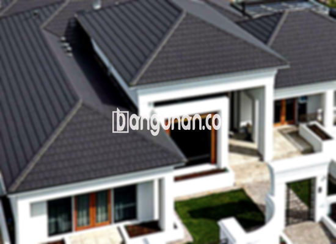

**Jual Genteng Kermaik & Beton di Kemang Bogor** – Membangun atau merenovasi rumah memerlukan material atap berkualitas, dan genteng adalah pilihan utama bagi banyak orang. Mitra Bangunan di Kemang Bogor hadir untuk menyediakan solusi atap yang tahan lama, estetis, dan terjangkau. Genteng tidak hanya melindungi rumah Anda dari hujan dan panas, tetapi juga meningkatkan nilai properti Anda secara signifikan. Dengan berbagai pilihan yang tersedia, kami membantu Anda menemukan genteng yang paling sesuai dengan kebutuhan dan gaya arsitektur rumah Anda.

Mempertimbangkan berbagai jenis genteng yang ada di pasaran adalah langkah penting sebelum membuat keputusan. Setiap jenis genteng memiliki kelebihan dan kekurangan masing-masing, dari harga hingga perawatan. Investasi pada genteng berkualitas akan memberikan ketenangan pikiran dan melindungi investasi properti Anda dalam jangka panjang. Pilihlah material yang tahan terhadap cuaca ekstrem dan sesuai dengan anggaran yang telah ditetapkan.



## Harga Genteng dari Toko Jual Genteng Kermaik & Beton di Kemang Bogor

Bagi Anda yang sedang mencari referensi harga, berikut adalah gambaran perkiraan biaya beberapa jenis genteng yang tersedia di toko kami di Kemang Bogor. Harga dapat bervariasi tergantung pada merek, kualitas, dan ukuran, namun kami selalu berusaha menawarkan harga yang kompetitif dan transparan. Kami sarankan untuk menghubungi kami langsung untuk mendapatkan penawaran harga terkini dan informasi lebih lanjut.

### - Harga Genteng Metal di Toko Genteng Kermaik & Beton di Kemang Bogor

Genteng metal menjadi semakin populer karena ringan, kuat, dan tahan lama. Material ini juga menawarkan berbagai pilihan warna dan desain yang modern. Pemasangan genteng metal relatif cepat dan mudah, menjadikannya pilihan yang ideal untuk renovasi atau pembangunan baru.

### - Harga Genteng Aspal di Toko Genteng Kermaik & Beton di Kemang Bogor

Genteng aspal memberikan tampilan yang elegan dan klasik, cocok untuk berbagai gaya arsitektur rumah. Material ini menawarkan daya tahan yang baik terhadap cuaca ekstrem dan tahan terhadap api. Selain itu, genteng aspal juga memberikan isolasi yang baik, membantu menjaga suhu ruangan tetap nyaman.

### - Harga Genteng Kermaik & Beton di Kemang Bogor

Genteng keramik dan beton adalah pilihan tradisional yang terbukti keandalannya. Kedua jenis genteng ini menawarkan kekuatan, ketahanan, dan variasi desain yang luas. Anda dapat memilih dari berbagai warna, tekstur, dan bentuk untuk menciptakan tampilan atap yang unik dan sesuai dengan selera Anda.

### - Harga Genteng Kaca di Toko Genteng Kermaik & Beton di Kemang Bogor

Genteng kaca sering digunakan sebagai elemen dekoratif untuk menciptakan tampilan yang dramatis dan modern. Meskipun tidak digunakan sebagai penutup atap utama, genteng kaca dapat memberikan pencahayaan alami yang indah di dalam ruangan. Anda dapat berkonsultasi dengan tim kami untuk menentukan cara terbaik untuk mengintegrasikan genteng kaca ke dalam desain atap Anda.

### - Harga Genteng Seng di Toko Genteng Kermaik & Beton di Kemang Bogor

Genteng seng merupakan pilihan ekonomis yang cocok untuk bangunan sederhana atau renovasi dengan anggaran terbatas. Material ini ringan, mudah dipasang, dan tahan terhadap korosi. Pemasangan yang tepat dengan paku yang kuat akan memastikan keawetan dan keamanan atap Anda.

### - Harga Genteng Beton di Toko Genteng Kermaik & Beton di Kemang Bogor

Genteng beton menawarkan kombinasi ideal antara kekuatan, daya tahan, dan harga yang terjangkau. Terbuat dari campuran semen, pasir, dan air, genteng ini tahan terhadap cuaca ekstrem dan membutuhkan perawatan minimal. Genteng beton adalah pilihan yang cerdas untuk investasi jangka panjang.



## Berbagai Macam Ragam Genteng dari Toko Jual Genteng Kermaik & Beton di Kemang Bogor

Anda memiliki beragam pilihan jenis genteng untuk memenuhi kebutuhan spesifik proyek pembangunan Anda. Berikut adalah beberapa jenis genteng yang tersedia di toko kami di Kemang Bogor:

### Genteng Keramik dari Toko Jual Genteng Kermaik & Beton di Kemang Bogor

Genteng keramik adalah pilihan populer bagi Anda yang menginginkan tampilan klasik dan elegan. Material ini memberikan isolasi termal yang baik, membantu menjaga suhu ruangan tetap nyaman sepanjang tahun. Genteng keramik juga tahan terhadap cuaca ekstrem dan tahan lama, menjadikannya investasi yang cerdas.

### Genteng Seng dan Genteng Kermaik & Beton di Kemang Bogor

Genteng seng menawarkan solusi hemat biaya untuk proyek pembangunan Anda. Dengan ukurannya yang relatif besar, genteng ini dapat menutupi area yang luas dengan cepat. Pemasangan yang tepat dengan paku yang kuat akan memastikan keawetan dan keamanan atap Anda.

### Genteng Asbes dan Genteng Kermaik & Beton di Kemang Bogor

Genteng asbes adalah pilihan yang terjangkau, tetapi perlu dipertimbangkan dengan hati-hati karena potensi dampak lingkungannya. Meskipun ringan dan tahan lama, genteng asbes mengandung serat yang dapat membahayakan kesehatan.

### Genteng Kanopi Baja Ringan dan Genteng Kermaik & Beton di Kemang Bogor

Genteng kanopi baja ringan menawarkan kombinasi ideal antara kekuatan, ringan, dan ketahanan terhadap korosi. Material ini cocok untuk berbagai jenis atap dan memberikan tampilan modern yang menarik. Genteng baja ringan juga mudah dipasang dan dirawat.

### Genteng Sirap Kayu Ulin dan Genteng Kermaik & Beton di Kemang Bogor

Genteng sirap kayu ulin memberikan sentuhan alami dan tradisional pada rumah Anda. Terbuat dari kayu ulin yang tahan lama, genteng ini menawarkan keindahan dan keunikan tersendiri. Namun, perawatan yang rutin diperlukan untuk menjaga keawetan dan tampilannya.

Mitra Bangunan siap membantu Anda memilih jenis genteng yang paling sesuai dengan kebutuhan dan anggaran Anda di Kemang Bogor. Kami menawarkan berbagai pilihan genteng berkualitas tinggi dengan harga yang kompetitif. Hubungi kami segera untuk mendapatkan penawaran harga terbaik dan layanan konsultasi gratis.

**Ref by:**  [Genteng Kermaik & Beton  Kemang Bogor](https://id.wikipedia.org/wiki/Genteng)