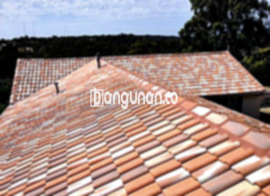

**Jual Genteng Kermaik & Beton di Kemanggisan Jakarta** – Genteng adalah material hunian yang sangat penting untuk dimiliki setiap pemilik rumah. Melindungi bangunan dari hujan, panas terik, dan berbagai kondisi cuaca lainnya, genteng berperan krusial dalam menjaga keamanan dan kenyamanan tempat tinggal Anda. Mitra Bangunan di Kemanggisan Jakarta menyediakan berbagai pilihan genteng berkualitas untuk memastikan atap rumah Anda kokoh dan terpercaya.

Memilih jenis genteng yang tepat memerlukan pertimbangan matang. Ada banyak sekali variasi genteng yang tersedia, masing-masing dengan kelebihan dan kekurangan unik. Mengetahui kebutuhan spesifik rumah Anda dan menyesuaikan pilihan genteng akan memastikan investasi yang tepat untuk jangka panjang. Pertimbangkan faktor seperti estetika, anggaran, dan kondisi iklim setempat saat membuat keputusan.



## Informasi Harga Genteng dari Toko Jual Genteng Kermaik & Beton di Kemanggisan Jakarta

Toko kami menyediakan beragam jenis genteng dengan harga yang kompetitif. Berikut adalah gambaran umum harga berbagai jenis genteng yang bisa Anda pertimbangkan. Perlu diingat bahwa harga dapat berubah sesuai dengan merek, kualitas, dan kuantitas pesanan.

### \- Harga Genteng Metal di Toko Genteng Kermaik & Beton di Kemanggisan Jakarta

Genteng metal adalah pilihan yang sangat digemari karena tampilannya yang modern dan kekuatannya. Seringkali digunakan pada desain rumah minimalis, material ini memberikan kesan elegan dan bersih. Informasi harga lengkap dapat Anda temukan dalam tabel harga atau dengan menghubungi tim kami.

### \- Harga Genteng Aspal di Toko Genteng Kermaik & Beton di Kemanggisan Jakarta

Genteng aspal dikenal karena fleksibilitas dan daya tahannya. Dibuat dari serat kayu dan aspal, material ini tahan terhadap api dan memberikan isolasi yang baik. Untuk mengetahui harga terbaru, silakan merujuk pada tabel harga yang tersedia. Anda dapat melihat perbandingan harga dengan material lain di Kemanggisan Jakarta.

### \- Harga Genteng Kermaik & Beton di Kemanggisan Jakarta

Genteng keramik dan beton merupakan pilihan klasik dan populer. Keduanya menawarkan beragam warna dan desain, memungkinkan Anda menyesuaikan tampilan atap rumah sesuai gaya arsitektur yang Anda inginkan. Informasi harga detail tersedia pada daftar harga kami.

### \- Harga Genteng Kaca di Toko Genteng Kermaik & Beton di Kemanggisan Jakarta

Genteng kaca sering digunakan untuk menciptakan efek pencahayaan alami pada ruangan. Namun, perlu diingat bahwa penggunaan berlebihan dapat meningkatkan panas di dalam ruangan. Anda dapat menemukan informasi harga terkini pada tabel harga yang kami sediakan.

### \- Harga Genteng Seng di Toko Genteng Kermaik & Beton di Kemanggisan Jakarta

Genteng seng adalah pilihan ekonomis yang ideal untuk proyek dengan anggaran terbatas. Ukurannya yang panjang membuatnya efisien dalam pemasangan. Pastikan untuk menggunakan paku yang kuat untuk memastikan pemasangan yang tahan lama. Detail harga tersedia pada tabel harga.

### \- Harga Genteng Beton di Toko Genteng Kermaik & Beton di Kemanggisan Jakarta

Genteng beton merupakan pilihan yang kuat dan tahan lama, terbuat dari campuran semen, pasir, dan air berkualitas tinggi. Material ini membutuhkan perawatan minimal dan cocok untuk berbagai kondisi cuaca. Untuk penawaran harga terbaik, silakan lihat tabel harga yang tersedia.



## Berbagai Jenis Genteng Tersedia di Toko Jual Genteng Kermaik & Beton di Kemanggisan Jakarta

Kami menyediakan berbagai macam jenis genteng untuk memenuhi kebutuhan bangunan Anda. Di bawah ini adalah beberapa pilihan populer yang tersedia di toko kami:

### Genteng Keramik dari Toko Jual Genteng Kermaik & Beton di Kemanggisan Jakarta

Genteng keramik adalah pilihan yang ideal untuk Anda yang mencari material atap yang estetis dan tahan lama. Dengan beragam bentuk, warna, dan desain, genteng keramik dapat mempercantik tampilan rumah Anda dan memberikan perlindungan optimal terhadap panas matahari.

### Genteng Seng dan Genteng Kermaik & Beton di Kemanggisan Jakarta

Genteng seng adalah pilihan ekonomis dan praktis. Ukurannya yang panjang membuatnya efisien untuk pemasangan, dan dapat menghemat biaya dibandingkan beberapa jenis genteng lainnya. Anda juga perlu mempertimbangkan paku yang kuat agar pemasangan tahan lama.

### Genteng Asbes dan Genteng Kermaik & Beton di Kemanggisan Jakarta

Genteng asbes dulunya populer, tetapi seiring waktu cenderung kurang diminati karena sifatnya yang kurang tahan lama dan potensi masalah kesehatan terkait serat asbes. Saat ini, lebih banyak orang memilih bahan alternatif yang lebih aman dan awet.

### Genteng Kanopi Baja Ringan dan Genteng Kermaik & Beton di Kemanggisan Jakarta

Genteng kanopi baja ringan menawarkan kombinasi antara kekuatan, ringan, dan desain modern. Material ini tahan lama, mudah dipasang, dan cocok untuk berbagai jenis atap, sehingga dapat memberikan tampilan yang menarik dan fungsional.

### Genteng Sirap Kayu Ulin dan Genteng Kermaik & Beton di Kemanggisan Jakarta

Genteng sirap kayu ulin menawarkan keindahan alami dan tampilan tradisional yang unik. Terbuat dari kayu ulin berkualitas tinggi, genteng ini tahan lama dan memberikan perlindungan yang baik terhadap cuaca ekstrem. Struktur kayu alami memberikan sentuhan hangat dan alami pada hunian Anda.

Anda dapat menemukan Genteng Kermaik & Beton di Kemanggisan Jakarta yang paling sesuai dengan kebutuhan dan budget Anda. Segera hubungi kami [melalui tombol WhatsApp atau Telepon di halaman ini](URL) atau kunjungi toko kami untuk mendapatkan penawaran terbaik dan konsultasi gratis. Mitra Bangunan siap membantu Anda mewujudkan atap impian Anda.

**Ref by:**  [Genteng Kermaik & Beton  Kemanggisan Jakarta](https://id.wikipedia.org/wiki/Genteng)