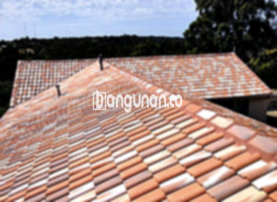

**Jual Genteng Kermaik & Beton di Kemayoran Jakarta** – Genteng adalah komponen material rumah yang sangat penting yang seharusnya dimiliki setiap pemilik hunian. Genteng berfungsi menjaga rumah Anda dari berbagai kondisi cuaca seperti hujan lebat dan panas matahari yang terik. Investasi pada genteng berkualitas akan memastikan rumah Anda terlindungi dan nyaman dalam jangka waktu yang lama. Mitra Bangunan hadir sebagai solusi terpercaya untuk kebutuhan genteng Anda di Kemayoran Jakarta.

Memilih genteng yang tepat memerlukan pertimbangan matang, karena ada berbagai jenis genteng dengan karakteristik masing-masing. Setiap jenis memiliki kelebihan dan kekurangan. Kami memahami bahwa setiap orang memiliki preferensi tersendiri, dan kami siap membantu Anda menemukan genteng yang paling sesuai dengan kebutuhan dan gaya arsitektur rumah Anda.



## Informasi Harga Genteng dari Toko Jual Genteng Kermaik & Beton di Kemayoran Jakarta

Berbagai macam pilihan genteng tersedia, masing-masing dengan harga dan kualitas yang berbeda. Memahami rentang harga dapat membantu Anda merencanakan anggaran proyek pembangunan atau renovasi atap rumah Anda. Berikut adalah perkiraan harga beberapa jenis genteng yang populer di pasaran:

### \- Harga Genteng Metal dari Toko Genteng Kermaik & Beton di Kemayoran Jakarta

Genteng metal merupakan pilihan modern dan praktis yang banyak diminati. Selain ringan dan mudah dipasang, genteng metal juga dikenal karena ketahanannya terhadap cuaca ekstrem. Dengan beragam pilihan warna dan desain, genteng metal dapat memberikan tampilan yang elegan dan minimalis pada atap rumah Anda.

### \- Harga Genteng Aspal dari Toko Genteng Kermaik & Beton di Kemayoran Jakarta

Genteng aspal menawarkan kombinasi estetika dan performa yang menarik. Terbuat dari serat kayu dan aspal berkualitas tinggi, genteng ini tidak hanya tahan lama, tetapi juga mampu meredam suara bising dari luar. Genteng aspal tersedia dalam berbagai warna dan tekstur yang dapat mempercantik tampilan rumah Anda.

### \- Harga Genteng Kermaik & Beton di Kemayoran Jakarta

Genteng keramik dan beton adalah pilihan klasik yang tetap populer hingga kini. Bahan-bahan ini dikenal karena kekuatan, daya tahan, dan kemampuannya untuk menahan panas. Anda dapat menemukan berbagai pilihan warna dan desain untuk menciptakan tampilan atap yang unik dan sesuai dengan selera Anda.

### \- Harga Genteng Kaca dari Toko Genteng Kermaik & Beton di Kemayoran Jakarta

Genteng kaca sering digunakan sebagai elemen dekoratif pada atap rumah. Pemasangan genteng kaca dapat memberikan efek pencahayaan alami yang indah di dalam ruangan. Namun, perlu diingat bahwa genteng kaca tidak cocok digunakan sebagai penutup atap utama karena dapat meningkatkan suhu ruangan secara signifikan.

### \- Harga Genteng Seng dari Toko Genteng Kermaik & Beton di Kemayoran Jakarta

Genteng seng merupakan pilihan ekonomis yang sering digunakan pada bangunan-bangunan tradisional. Dengan harga yang terjangkau, genteng seng dapat menjadi solusi praktis untuk melindungi atap rumah Anda dari hujan. Namun, perlu diingat bahwa genteng seng memerlukan perawatan rutin untuk mencegah korosi.

### \- Harga Genteng Beton dari Toko Genteng Kermaik & Beton di Kemayoran Jakarta

Genteng beton adalah pilihan yang sangat kuat dan tahan lama. Terbuat dari campuran semen, pasir, dan air berkualitas tinggi, genteng ini mampu menahan beban yang berat dan tahan terhadap cuaca ekstrem. Genteng beton adalah investasi jangka panjang yang tepat untuk rumah Anda.



## Berbagai Macam Pilihan Genteng dari Toko Jual Genteng Kermaik & Beton di Kemayoran Jakarta

Untuk membantu Anda memilih genteng yang paling sesuai dengan kebutuhan dan gaya rumah Anda, berikut adalah beberapa jenis genteng yang tersedia di toko kami:

### Genteng Keramik dari Toko Jual Genteng Kermaik & Beton di Kemayoran Jakarta

Genteng keramik menawarkan estetika yang klasik dan tahan lama. Jenis genteng ini memberikan perlindungan optimal terhadap panas matahari dan hujan lebat. Dengan beragam pilihan warna dan tekstur, Anda dapat menciptakan tampilan atap yang unik dan personal. Anda dapat menemukan inspirasi desain dengan melihat [Jual Genteng Kermaik & Beton di Angke Jakarta](/jual-genteng-kermaik-beton-di-angke-jakarta/).

### Genteng Seng dan Genteng Kermaik & Beton di Kemayoran Jakarta

Genteng seng adalah pilihan ekonomis yang ideal bagi Anda yang mencari solusi praktis dan terjangkau. Meskipun ringan dan mudah dipasang, genteng seng tetap memberikan perlindungan yang memadai terhadap cuaca. Pastikan untuk menggunakan paku yang kuat agar genteng seng terpasang dengan aman dan kokoh.

### Genteng Asbes dan Genteng Kermaik & Beton di Kemayoran Jakarta

Genteng asbes adalah jenis genteng yang cukup popular di masa lalu. Namun, perlu diingat bahwa genteng asbes memiliki beberapa kelemahan, seperti daya tahan yang rendah dan potensi bahaya kesehatan. Saat ini, ada banyak alternatif genteng yang lebih aman dan tahan lama yang tersedia di pasaran.

### Genteng Kanopi Baja Ringan dan Genteng Kermaik & Beton di Kemayoran Jakarta

Genteng kanopi baja ringan menawarkan kombinasi kekuatan, ringan, dan estetika yang menarik. Jenis genteng ini sangat cocok untuk digunakan pada bangunan dengan desain modern dan minimalis. Dengan beragam pilihan warna dan desain, Anda dapat menciptakan tampilan atap yang stylish dan elegan.

### Genteng Sirap Kayu Ulin dan Genteng Kermaik & Beton di Kemayoran Jakarta

Genteng sirap kayu ulin menawarkan tampilan alami dan estetis yang unik. Terbuat dari kayu ulin berkualitas tinggi, genteng ini memiliki daya tahan yang baik dan memberikan kesan hangat pada rumah Anda. Genteng sirap kayu ulin cocok digunakan pada bangunan dengan desain tradisional atau tropis.

Anda dapat menemukan berbagai macam Genteng Kermaik & Beton di Kemayoran Jakarta yang sesuai dengan preferensi Anda. Mitra Bangunan siap membantu Anda memilih genteng yang tepat dengan memberikan saran profesional dan penawaran harga terbaik. Jangan ragu untuk menghubungi kami melalui tombol WhatsApp atau Telepon di halaman ini untuk informasi lebih lanjut.

**Ref by:**  [Genteng Kermaik & Beton  Kemayoran Jakarta](https://id.wikipedia.org/wiki/Genteng)