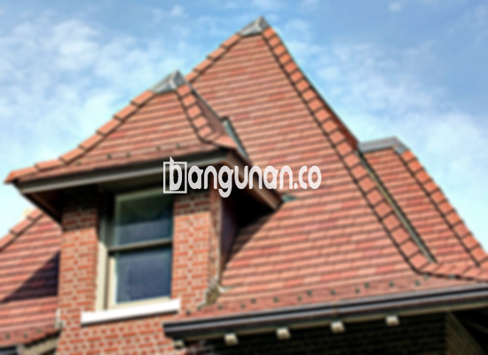

**Jual Genteng Kermaik & Beton di Kembangan Jakarta** – Genteng merupakan salah satu material hunian yang sangat penting dan wajib dimiliki setiap pemilik rumah. Perlindungan optimal terhadap berbagai kondisi cuaca seperti hujan dan panas terik matahari adalah fungsi utamanya. Memiliki genteng yang berkualitas akan membuat rumah terasa lebih nyaman dan aman. Bagi Mitra Bangunan di Kembangan Jakarta, menemukan genteng yang tepat tidak perlu lagi menjadi kesulitan.

Mencari material bangunan yang sesuai dengan kebutuhan dan anggaran memang membutuhkan perencanaan matang. Terlebih untuk elemen penting seperti genteng, yang akan menentukan kekokohan dan estetika atap rumah Anda. Kami hadir sebagai solusi terpercaya untuk menyediakan berbagai jenis genteng berkualitas di Kembangan Jakarta.



## Harga Genteng dari Toko Jual Genteng Kermaik & Beton di Kembangan Jakarta

Ketersediaan pilihan genteng yang beragam memungkinkan Anda menemukan material yang paling sesuai dengan kebutuhan dan preferensi bangunan Anda. Setiap jenis genteng memiliki kelebihan dan karakteristik uniknya masing-masing. Berikut adalah informasi mengenai beberapa variasi harga genteng yang bisa Anda jadikan referensi:

### - Harga Genteng Metal di Toko Genteng Kermaik & Beton di Kembangan Jakarta

Genteng metal menjadi favorit banyak orang karena sifatnya yang ringan dan kemudahan pemasangannya. Material ini cocok untuk bangunan modern dengan gaya minimalis, dan memberikan tampilan atap yang elegan. Untuk mengetahui harga terkini genteng metal, silakan merujuk pada tabel harga yang tersedia atau segera hubungi tim kami.

### - Harga Genteng Aspal di Toko Genteng Kermaik & Beton di Kembangan Jakarta

Genteng aspal menawarkan keunggulan dalam daya tahan dan kemampuannya meredam suara hujan. Terbuat dari serat kayu dan aspal berkualitas tinggi, material ini memberikan perlindungan optimal dan nyaman bagi penghuni rumah. Informasi harga genteng aspal bisa Anda peroleh dengan melihat tabel harga atau menghubungi kami langsung.

### - Harga Genteng Kermaik & Beton di Kembangan Jakarta

Genteng keramik dan beton adalah pilihan klasik yang tetap diminati karena kekuatan dan keawetannya. Pilihan warna dan desain yang luas memungkinkan Anda menciptakan tampilan atap yang sesuai dengan selera. Detail harga genteng keramik dan beton bisa Anda temukan pada tabel harga yang disediakan.

### - Harga Genteng Kaca di Toko Genteng Kermaik & Beton di Kembangan Jakarta

Genteng kaca seringkali digunakan sebagai elemen dekoratif untuk memberikan sentuhan unik dan pencahayaan alami pada sebuah bangunan. Namun, perlu diingat bahwa penggunaan genteng kaca secara berlebihan dapat menyebabkan ruangan terasa lebih panas. Informasi harga dan stok terkini dapat Anda tanyakan kepada tim kami.

### - Harga Genteng Seng di Toko Genteng Kermaik & Beton di Kembangan Jakarta

Genteng seng merupakan opsi ekonomis yang sering digunakan untuk bangunan dengan anggaran terbatas. Dengan bentuknya yang panjang, genteng seng dapat menutupi area atap dengan efisien. Untuk informasi harga genteng seng terbaru, silakan merujuk ke tabel harga yang tersedia.

### - Harga Genteng Beton di Toko Genteng Kermaik & Beton di Kembangan Jakarta

Genteng beton dikenal sebagai material yang kokoh dan tahan lama, ideal untuk menghadapi berbagai kondisi cuaca ekstrem. Terbuat dari campuran semen, pasir, dan air berkualitas tinggi, genteng beton memberikan perlindungan maksimal bagi bangunan Anda. Detail harga genteng beton terbaru dapat Anda akses melalui tabel harga atau dengan menghubungi tim kami yang siap membantu.



## Berbagai Macam Ragam Genteng dari Toko Jual Genteng Kermaik & Beton di Kembangan Jakarta

Kami menyediakan beragam jenis genteng untuk memenuhi kebutuhan konstruksi Anda di Kembangan Jakarta. Berikut adalah beberapa pilihan yang tersedia, dengan penjelasan mengenai keunggulan masing-masing:

### Genteng Keramik dari Toko Jual Genteng Kermaik & Beton di Kembangan Jakarta

Genteng keramik merupakan pilihan yang populer karena keindahan estetikanya dan kemampuannya menahan panas. Anda dapat memilih dari berbagai warna dan motif untuk menciptakan tampilan atap yang unik dan sesuai dengan gaya arsitektur rumah Anda. Dengan perawatan yang baik, genteng keramik dapat bertahan lama dan memberikan nilai tambah pada properti Anda. Anda akan sangat terbantu dengan kemudahan perawatan yang ditawarkan keramik. 

### Genteng Seng dan Genteng Kermaik & Beton di Kembangan Jakarta

Genteng seng adalah pilihan praktis dan terjangkau, terutama untuk proyek konstruksi dengan anggaran terbatas. Keunggulan utama genteng seng terletak pada ringan dan mudah dipasang.  Meskipun demikian, penting untuk memastikan pemasangan dilakukan dengan benar untuk mencegah kebocoran dan memastikan ketahanannya.

### Genteng Asbes dan Genteng Kermaik & Beton di Kembangan Jakarta

Genteng asbes dulu sering digunakan karena harganya yang murah. Namun, saat ini, banyak orang menghindari penggunaannya karena potensi masalah kesehatan yang terkait dengan serat asbes.  Pertimbangkan alternatif lain yang lebih aman dan ramah lingkungan. Anda juga perlu memperhatikan daya tahannya.

### Genteng Kanopi Baja Ringan dan Genteng Kermaik & Beton di Kembangan Jakarta

Genteng kanopi baja ringan menjadi pilihan modern yang semakin populer karena ringan, kuat, dan tahan karat. Material ini cocok untuk berbagai jenis bangunan dan memberikan perlindungan maksimal terhadap cuaca ekstrem. Anda bisa mendapatkan informasi lebih lanjut tentang genteng baja ringan dari tim kami.

### Genteng Sirap Kayu Ulin dan Genteng Kermaik & Beton di Kembangan Jakarta

Genteng sirap kayu ulin menawarkan tampilan alami dan unik yang dapat memberikan kesan hangat pada bangunan Anda. Terbuat dari kayu ulin yang kuat dan tahan lama, genteng ini menjadi pilihan yang menarik bagi mereka yang menginginkan desain tradisional. Anda akan menikmati keindahan alami dari kayu ulin.

Untuk Mitra Bangunan yang sedang mencari genteng berkualitas di Kembangan Jakarta, kami siap membantu Anda memilih material yang tepat sesuai dengan kebutuhan dan anggaran Anda. Jangan ragu untuk menghubungi kami melalui tombol WhatsApp atau Telepon yang tersedia di halaman ini untuk mendapatkan penawaran harga terbaik dan layanan konsultasi gratis.

**Ref by:**  [Genteng Kermaik & Beton  Kembangan Jakarta](https://id.wikipedia.org/wiki/Genteng)