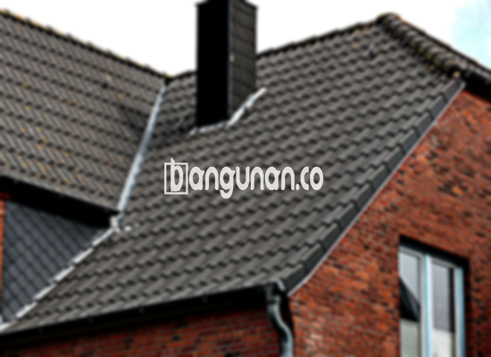

**Jual Genteng Kermaik & Beton di Kemiri Muka Depok** – Genteng merupakan material penting dalam setiap pembangunan hunian. Melindungi rumah Anda dari cuaca ekstrem seperti hujan dan panas terik, genteng juga berperan vital dalam menciptakan kenyamanan dan keamanan tempat tinggal. Bagi Mitra Bangunan di Kemiri Muka Depok, kami hadir sebagai solusi terpercaya untuk memenuhi kebutuhan genteng Anda dengan kualitas terbaik dan harga yang kompetitif. Memilih genteng yang tepat adalah investasi jangka panjang untuk hunian Anda.

Mempertimbangkan berbagai pilihan genteng dapat terasa membingungkan. Setiap jenis genteng memiliki karakteristik, kelebihan, dan kekurangan masing-masing. Penting bagi Anda untuk memahami perbedaan-perbedaan ini agar dapat membuat keputusan yang tepat sesuai dengan kebutuhan dan preferensi Anda. Dengan memahami opsi yang tersedia, Anda akan mampu memilih genteng yang paling sesuai dengan desain rumah dan anggaran yang telah disiapkan.



## Harga Genteng dari Toko Jual Genteng Kermaik & Beton di Kemiri Muka Depok

Kami menyediakan beragam variasi genteng dengan harga yang bervariasi, memungkinkan Anda memilih opsi yang paling sesuai dengan anggaran dan kebutuhan proyek Anda. Berikut adalah perkiraan harga beberapa jenis genteng yang tersedia di toko kami di Kemiri Muka Depok. Informasi ini diharapkan dapat membantu Anda dalam merencanakan anggaran pembangunan atau renovasi atap rumah Anda.

### \- Harga Genteng Metal di Toko Genteng Kermaik & Beton di Kemiri Muka Depok

Genteng metal adalah pilihan populer karena ringan, kuat, dan mudah dipasang. Sering digunakan pada rumah bergaya minimalis, genteng metal menawarkan tampilan modern dan elegan. Untuk mengetahui harga terkini genteng metal, Anda dapat merujuk pada tabel harga yang tersedia atau menghubungi tim kami untuk informasi lebih lanjut.

### \- Harga Genteng Aspal di Toko Genteng Kermaik & Beton di Kemiri Muka Depok

Genteng aspal menawarkan estetika yang menarik dan ketahanan yang baik terhadap cuaca. Terbuat dari serat kayu dan aspal, material ini memberikan tampilan yang unik dan alami pada atap rumah Anda. Silakan periksa tabel harga untuk mengetahui detail harga genteng aspal terbaru.

### \- Harga Genteng Kermaik & Beton di Kemiri Muka Depok

Genteng keramik dan beton merupakan pilihan klasik yang banyak disukai karena keindahan dan ketahanannya. Dengan berbagai pilihan warna dan desain, Anda dapat menciptakan tampilan atap yang sesuai dengan gaya rumah Anda. Informasi harga lengkap untuk genteng keramik dan beton dapat ditemukan pada tabel yang tersedia.

### \- Harga Genteng Kaca di Toko Genteng Kermaik & Beton di Kemiri Muka Depok

Genteng kaca sering digunakan sebagai aksen dekoratif pada atap untuk memberikan pencahayaan alami ke dalam ruangan. Meskipun tidak disarankan untuk digunakan secara menyeluruh, genteng kaca dapat menjadi sentuhan unik yang mempercantik tampilan rumah Anda. Detail harga genteng kaca terbaru dapat Anda temukan pada tabel harga.

### \- Harga Genteng Seng di Toko Genteng Kermaik & Beton di Kemiri Muka Depok

Genteng seng merupakan pilihan ekonomis yang cocok untuk proyek renovasi dengan anggaran terbatas. Dengan ukurannya yang panjang, genteng seng dapat menutupi area atap yang luas dengan efisien. Pastikan untuk menggunakan paku yang kuat saat pemasangan agar genteng seng terpasang dengan aman dan tahan lama.

### \- Harga Genteng Beton di Toko Genteng Kermaik & Beton di Kemiri Muka Depok

Genteng beton menawarkan kekuatan dan ketahanan yang luar biasa. Terbuat dari campuran semen, pasir, dan air berkualitas tinggi, genteng beton dapat bertahan terhadap cuaca ekstrem dan memberikan perlindungan optimal bagi rumah Anda. Anda dapat menemukan informasi harga genteng beton terkini pada tabel yang tersedia.



## Beberapa Jenis Genteng dari Toko Jual Genteng Kermaik & Beton di Kemiri Muka Depok

Kami menyediakan beragam jenis genteng untuk memenuhi kebutuhan berbagai proyek pembangunan dan renovasi. Berikut adalah beberapa jenis genteng yang dapat Anda pilih:

### Genteng Keramik dari Toko Jual Genteng Kermaik & Beton di Kemiri Muka Depok

Genteng keramik adalah pilihan yang populer karena keindahan dan ketahanannya. Dengan berbagai pilihan warna, desain, dan tekstur, Anda dapat menciptakan tampilan atap yang sesuai dengan gaya rumah Anda. Genteng keramik juga memberikan perlindungan optimal terhadap cuaca panas dan hujan.

### Genteng Seng dan Genteng Kermaik & Beton di Kemiri Muka Depok

Genteng seng, dengan ukurannya yang panjang, merupakan pilihan ekonomis yang sering digunakan pada bangunan tradisional. Pemasangan yang tepat dengan menggunakan paku yang kuat akan memastikan ketahanan dan keamanan atap Anda.

### Genteng Asbes dan Genteng Kermaik & Beton di Kemiri Muka Depok

Genteng asbes, meskipun dahulu sering digunakan, kini kurang direkomendasikan karena potensi bahaya kesehatan. Pertimbangkan alternatif yang lebih aman dan ramah lingkungan seperti genteng keramik atau beton.

### Genteng Kanopi Baja Ringan dan Genteng Kermaik & Beton di Kemiri Muka Depok

Genteng kanopi baja ringan menawarkan kombinasi kekuatan, ringan, dan tampilan modern. Material ini tahan terhadap korosi dan memberikan solusi atap yang tahan lama dan estetis.

### Genteng Sirap Kayu Ulin dan Genteng Kermaik & Beton di Kemiri Muka Depok

Genteng sirap kayu ulin adalah pilihan alami dan estetis yang memberikan tampilan tradisional pada rumah Anda. Terbuat dari kayu ulin berkualitas tinggi, genteng ini tahan terhadap cuaca dan memberikan kehangatan pada hunian Anda.

Anda dapat memilih berbagai jenis Genteng Kermaik & Beton di Kemiri Muka Depok yang paling sesuai dengan kebutuhan dan anggaran Anda. Hubungi kami sekarang juga untuk mendapatkan penawaran terbaik dan layanan konsultasi gratis. Sebagai Mitra Bangunan, kami siap membantu Anda mewujudkan atap impian Anda.

**Ref by:**  [Genteng Kermaik & Beton  Kemiri Muka Depok](https://id.wikipedia.org/wiki/Genteng)