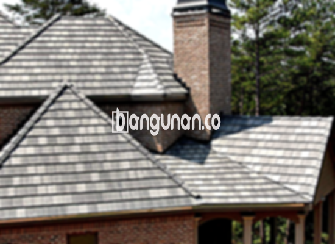

**Jual Genteng Kermaik & Beton di Kemiri Tangerang** – Genteng merupakan material hunian yang sangat penting dan sepatutnya dimiliki oleh setiap pemilik rumah. Melindungi tempat tinggal dari berbagai kondisi cuaca seperti hujan lebat atau terik matahari, genteng adalah investasi jangka panjang yang bijak. Mitra Bangunan hadir sebagai solusi terpercaya untuk kebutuhan atap Anda di Kemiri Tangerang, menawarkan beragam pilihan genteng berkualitas dengan harga kompetitif.

Membangun atau merenovasi rumah di Kemiri Tangerang memerlukan perencanaan yang matang, termasuk pemilihan material atap yang tepat. Dengan mempertimbangkan berbagai faktor seperti kekuatan, estetika, dan anggaran, Anda dapat menemukan genteng yang paling sesuai dengan kebutuhan dan preferensi Anda. Penting untuk memilih material yang tahan lama dan mampu melindungi hunian Anda dari elemen-elemen alam.



## Ragam Harga Genteng dari Toko Jual Genteng Kermaik & Beton di Kemiri Tangerang

Berbagai jenis genteng tersedia dengan rentang harga yang berbeda-beda, memungkinkan Anda menyesuaikan pilihan dengan anggaran yang telah ditetapkan. Kami menyediakan informasi harga yang transparan dan akurat untuk membantu Anda membuat keputusan yang tepat. Berikut adalah gambaran umum harga genteng yang dapat Anda temukan di toko kami.

### – Harga Genteng Metal di Toko Genteng Kermaik & Beton di Kemiri Tangerang

Genteng metal adalah pilihan yang semakin populer karena ringan, mudah dipasang, dan memiliki tampilan yang modern dan minimalis. Material ini sangat cocok untuk rumah-rumah bergaya kontemporer di Kemiri Tangerang.  Genteng metal juga tahan terhadap korosi dan cuaca ekstrem, menjadikannya investasi yang menguntungkan.

### – Harga Genteng Aspal di Toko Genteng Kermaik & Beton di Kemiri Tangerang

Genteng aspal menawarkan kombinasi antara estetika dan kekuatan. Terbuat dari serat kayu dan aspal berkualitas tinggi, genteng ini memiliki ketahanan yang baik terhadap cuaca dan mampu memberikan isolasi termal yang efektif. Anda dapat memilih dari berbagai warna dan tekstur untuk menciptakan tampilan atap yang menawan.

### – Harga Genteng Kermaik & Beton di Kemiri Tangerang

Genteng keramik dan beton adalah pilihan klasik yang tetap diminati hingga saat ini. Material ini dikenal karena kekuatan, ketahanan, dan kemampuannya menjaga suhu di dalam rumah tetap stabil. Dengan beragam pilihan warna dan desain, Anda dapat menyesuaikan genteng dengan gaya arsitektur rumah Anda.

### – Harga Genteng Kaca di Toko Genteng Kermaik & Beton di Kemiri Tangerang

Genteng kaca memberikan sentuhan unik dan elegan pada atap rumah. Material ini ideal digunakan sebagai aksen atau untuk menciptakan pencahayaan alami di ruangan tertentu. Meskipun tidak digunakan sebagai penutup atap utama karena kemampuannya menghantarkan panas, genteng kaca dapat menambah nilai estetika pada bangunan Anda.

### – Harga Genteng Seng di Toko Genteng Kermaik & Beton di Kemiri Tangerang

Genteng seng adalah pilihan ekonomis yang sering digunakan untuk bangunan-bangunan tradisional atau dengan anggaran terbatas. Dengan ukuran yang relatif panjang, genteng seng dapat menutupi area atap yang luas dengan lebih efisien. Pemasangan yang tepat dengan paku berkualitas sangat penting untuk memastikan kekokohan dan keawetan genteng seng.

### – Harga Genteng Beton di Toko Genteng Kermaik & Beton di Kemiri Tangerang

Genteng beton adalah pilihan yang kokoh dan tahan lama, terbuat dari campuran semen, pasir, dan air berkualitas tinggi. Material ini mampu menahan beban berat, tahan terhadap cuaca ekstrem, dan memiliki umur pakai yang panjang. Kami menyediakan berbagai pilihan genteng beton dengan berbagai bentuk dan warna untuk memenuhi kebutuhan Anda. Untuk informasi harga yang lebih detail, lihatlah tabel yang tersedia di halaman produk kami.



## Beragam Jenis Genteng dari Toko Jual Genteng Kermaik & Beton di Kemiri Tangerang

Kami menyediakan beragam jenis genteng untuk memenuhi kebutuhan dan preferensi bangunan Anda di Kemiri Tangerang.  Berikut adalah beberapa pilihan populer yang dapat Anda pertimbangkan.

### Genteng Keramik dari Toko Jual Genteng Kermaik & Beton di Kemiri Tangerang

Genteng keramik menawarkan kombinasi antara keindahan dan daya tahan. Material ini tersedia dalam berbagai warna, tekstur, dan desain, memungkinkan Anda menciptakan tampilan atap yang unik dan menarik. Genteng keramik juga memberikan isolasi termal yang baik, membantu menjaga rumah tetap sejuk di musim panas dan hangat di musim dingin.

### Genteng Seng dan Genteng Kermaik & Beton di Kemiri Tangerang

Genteng seng adalah pilihan yang ekonomis dan praktis, terutama untuk bangunan-bangunan dengan anggaran terbatas. Ukuran yang panjang dan pemasangan yang relatif mudah menjadikannya pilihan yang populer di kalangan pemilik rumah dan kontraktor. Pastikan untuk menggunakan paku berkualitas tinggi untuk memastikan pemasangan yang kokoh dan tahan lama.

### Genteng Asbes dan Genteng Kermaik & Beton di Kemiri Tangerang

Meskipun masih digunakan oleh sebagian orang, genteng asbes kurang direkomendasikan karena potensi bahaya kesehatan yang ditimbulkan oleh serat asbes. Material ini rentan terhadap kerusakan dan memerlukan perawatan ekstra untuk mencegah kebocoran dan kerusakan lainnya.

### Genteng Kanopi Baja Ringan dan Genteng Kermaik & Beton di Kemiri Tangerang

Genteng kanopi baja ringan adalah pilihan modern yang menawarkan kekuatan, ringan, dan estetika yang menarik. Material ini tahan terhadap korosi, cuaca ekstrem, dan memiliki umur pakai yang panjang. Dengan beragam pilihan desain dan warna, Anda dapat menciptakan tampilan atap yang sesuai dengan gaya rumah Anda.

### Genteng Sirap Kayu Ulin dan Genteng Kermaik & Beton di Kemiri Tangerang

Genteng sirap kayu ulin memberikan sentuhan alami dan tradisional pada bangunan Anda. Terbuat dari kayu ulin yang kuat dan tahan lama, genteng ini menawarkan nilai estetika yang unik dan berkontribusi pada tampilan eksterior rumah yang menawan. Material ini juga memiliki sifat insulasi yang baik, membantu menjaga suhu di dalam rumah tetap stabil.

Anda dapat dengan mudah menemukan Genteng Kermaik & Beton di Kemiri Tangerang yang sesuai dengan kebutuhan bangunan Anda. Kami siap membantu Anda dalam memilih jenis genteng yang paling tepat dan memberikan penawaran harga terbaik. Mitra Bangunan berkomitmen untuk menyediakan material berkualitas dan layanan yang memuaskan bagi seluruh pelanggan kami. Jangan ragu untuk menghubungi kami melalui tombol WhatsApp atau Telepon yang tersedia di halaman ini. Dengan senang hati kami akan memberikan informasi lebih lanjut dan membantu Anda mewujudkan proyek atap impian Anda.

**Ref by:**  [Genteng Kermaik & Beton  Kemiri Tangerang](https://id.wikipedia.org/wiki/Genteng)