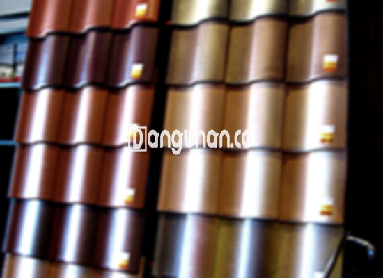

**Jual Genteng Kermaik & Beton di Kenari Jakarta** – Bagi Mitra Bangunan yang berencana membangun atau merenovasi atap rumah di Kenari Jakarta, pemilihan genteng yang tepat adalah kunci utama. Genteng bukan hanya pelindung utama rumah dari cuaca ekstrem seperti hujan dan panas, tetapi juga penentu estetika bangunan Anda. Kami menyediakan berbagai pilihan genteng berkualitas untuk memenuhi kebutuhan proyek Anda.

Investasi pada genteng yang berkualitas adalah langkah cerdas untuk jangka panjang. Ada beragam opsi yang tersedia, masing-masing dengan kelebihan dan kekurangannya. Memilih genteng yang sesuai dengan desain rumah dan anggaran Anda akan memberikan kenyamanan dan keamanan maksimal. Mari kita eksplorasi pilihan-pilihan terbaik yang tersedia di Kenari Jakarta.



## Harga Genteng dari Toko Jual Genteng Kermaik & Beton di Kenari Jakarta

Kami menyediakan beragam variasi genteng dengan harga yang kompetitif. Berikut adalah gambaran umum harga yang dapat Anda jadikan referensi. Untuk informasi harga terkini dan penawaran khusus, silakan hubungi tim kami.

### – Harga Genteng Metal di Toko Genteng Kermaik & Beton di Kenari Jakarta

Genteng metal merupakan pilihan populer karena kekuatannya dan tampilan modernnya. Banyak digunakan pada rumah minimalis, genteng ini memberikan kesan yang menarik dan terjangkau.

### – Harga Genteng Aspal di Toko Genteng Kermaik & Beton di Kenari Jakarta

Genteng aspal terbuat dari serat kayu dan aspal, menawarkan fleksibilitas dan daya tahan tinggi. Material ini tahan api dan banyak diminati karena keunggulannya.

### – Harga Genteng Kermaik & Beton di Kenari Jakarta

Genteng keramik dikenal dengan keindahan dan variasi warnanya. Jenis genteng ini memberikan sentuhan klasik dan elegan pada bangunan Anda.

### – Harga Genteng Kaca di Toko Genteng Kermaik & Beton di Kenari Jakarta

Genteng kaca sering digunakan sebagai aksen untuk memberikan pencahayaan alami pada ruangan. Namun, penggunaan genteng kaca sebaiknya tidak terlalu luas karena dapat meningkatkan suhu ruangan.

### – Harga Genteng Seng di Toko Genteng Kermaik & Beton di Kenari Jakarta

Genteng seng merupakan pilihan ekonomis yang sering ditemukan pada bangunan-bangunan lama. Ukurannya yang panjang membuat pemasangan lebih efisien. 

### – Harga Genteng Beton di Toko Genteng Kermaik & Beton di Kenari Jakarta

Genteng beton terbuat dari campuran semen, pasir, dan air, sehingga sangat kokoh dan tahan lama. Pilihan ideal bagi Anda yang menginginkan atap yang kuat dan awet.



## Beberapa Variasi Genteng dari Toko Jual Genteng Kermaik & Beton di Kenari Jakarta

Selain jenis-jenis di atas, berikut adalah beberapa variasi genteng lain yang tersedia di toko kami:

### Genteng Keramik dari Toko Jual Genteng Kermaik & Beton di Kenari Jakarta

Genteng keramik merupakan pilihan yang tepat bagi Anda yang menginginkan tampilan rumah yang menarik dan tahan lama. Kemampuan genteng keramik dalam melindungi dari panas matahari juga menjadi keunggulannya.

### Genteng Seng dan Genteng Kermaik & Beton di Kenari Jakarta

Genteng seng banyak digunakan di masa lalu karena ukurannya yang panjang dan hemat biaya. Untuk hasil yang optimal, pastikan genteng seng dipasang dengan paku yang kuat.

### Genteng Asbes dan Genteng Kermaik & Beton di Kenari Jakarta

Meskipun dahulu populer, genteng asbes kini kurang direkomendasikan karena mudah rusak dan kurang tahan lama. Pertimbangkan opsi lain yang lebih berkualitas.

### Genteng Kanopi Baja Ringan dan Genteng Kermaik & Beton di Kenari Jakarta

Genteng kanopi baja ringan menawarkan kombinasi antara kekuatan, kelenturan, dan tampilan modern. Cocok untuk berbagai jenis atap.

### Genteng Sirap Kayu Ulin dan Genteng Kermaik & Beton di Kenari Jakarta

Genteng sirap kayu ulin terbuat dari kayu ulin yang kuat dan tahan lama. Pilihan yang menarik untuk memberikan sentuhan alami pada rumah Anda.

Anda dapat memilih jenis Genteng Kermaik & Beton di Kenari Jakarta yang sesuai dengan kebutuhan dan anggaran Anda. Tentukan jumlah, bahan genteng, dan variasi yang Anda inginkan, dan kami akan siap membantu. Jangan ragu untuk menghubungi kami untuk mendapatkan penawaran harga terbaik dan layanan konsultasi gratis. Mitra Bangunan siap menjadi mitra terpercaya Anda dalam pembangunan!

**Ref by:**  [Genteng Kermaik & Beton  Kenari Jakarta](https://id.wikipedia.org/wiki/Genteng)