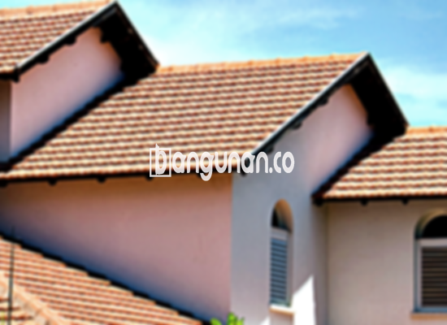

**Jual Genteng Kermaik & Beton di Kencana Bogor** – Genteng merupakan material hunian yang sangat penting yang harus dimiliki setiap pemilik rumah. Melindungi tempat tinggal dari berbagai kondisi cuaca seperti hujan deras, terik matahari, dan elemen lainnya adalah fungsi utamanya. Bagi Mitra Bangunan di Kencana Bogor yang membutuhkan perlindungan optimal untuk rumah mereka, kami menyediakan beragam pilihan genteng berkualitas tinggi. Kami memahami betul pentingnya memilih material atap yang tepat untuk kenyamanan dan keamanan jangka panjang.

Memastikan rumah terlindungi dengan baik memerlukan pemilihan material yang tepat. Ada banyak sekali jenis genteng yang tersedia, masing-masing memiliki karakteristik dan kegunaan yang berbeda. Penting bagi Anda untuk mempertimbangkan gaya arsitektur rumah, iklim setempat, serta anggaran yang tersedia dalam proses pemilihan. Kami hadir sebagai mitra terpercaya untuk membantu Anda menemukan solusi atap yang paling sesuai dengan kebutuhan Anda di Kencana Bogor.



## Harga Genteng dari Toko Jual Genteng Kermaik & Beton di Kencana Bogor

Memahami kisaran harga berbagai jenis genteng sangat penting sebelum Anda memutuskan untuk membeli. Informasi harga yang jelas akan membantu Anda dalam merencanakan anggaran dan memilih opsi yang paling sesuai dengan kemampuan finansial Anda. Berikut ini adalah gambaran harga beberapa jenis genteng yang tersedia di toko kami di Kencana Bogor.

### Harga Genteng Metal di Toko Genteng Kermaik & Beton di Kencana Bogor

Genteng metal semakin populer karena kesan modern dan ringan yang ditawarkannya. Material ini seringkali menjadi pilihan utama untuk rumah bergaya minimalis. Agar mendapatkan informasi harga terkini untuk genteng metal, silakan merujuk pada tabel harga yang kami sediakan.

### Harga Genteng Aspal di Toko Genteng Kermaik & Beton di Kencana Bogor

Genteng aspal dikenal dengan kekuatan dan kemampuannya menahan cuaca ekstrem. Terbuat dari kombinasi serat kayu dan aspal berkualitas tinggi, genteng ini menawarkan keawetan dan ketahanan yang luar biasa. Untuk melihat harga genteng aspal terbaru, silakan periksa tabel harga yang tersedia.

### Harga Genteng Kermaik & Beton di Kencana Bogor

Genteng keramik memancarkan keindahan klasik dan memberikan sentuhan unik pada rumah Anda. Dengan berbagai pilihan warna dan motif yang tersedia, Anda dapat menciptakan tampilan rumah yang sesuai dengan selera pribadi Anda. Kami menyediakan tabel harga genteng keramik untuk kemudahan referensi Anda.

### Harga Genteng Kaca di Toko Genteng Kermaik & Beton di Kencana Bogor

Genteng kaca dapat menjadi pilihan menarik untuk memberikan pencahayaan alami pada ruangan Anda. Namun, perlu diingat bahwa penggunaan genteng kaca yang berlebihan dapat meningkatkan suhu ruangan. Informasi harga genteng kaca dapat ditemukan pada tabel harga yang kami sediakan.

### Harga Genteng Seng di Toko Genteng Kermaik & Beton di Kencana Bogor

Genteng seng merupakan pilihan ekonomis yang sering digunakan pada bangunan tradisional. Dengan ukurannya yang panjang dan harga yang terjangkau, genteng seng dapat menjadi solusi praktis untuk anggaran terbatas. Informasi harga genteng seng terbaru tersedia pada tabel harga kami.

### Harga Genteng Beton di Toko Genteng Kermaik & Beton di Kencana Bogor

Genteng beton menawarkan ketahanan dan kekuatan yang luar biasa, menjadikannya pilihan ideal untuk berbagai jenis bangunan. Terbuat dari campuran semen, pasir, dan air berkualitas tinggi, genteng beton tahan terhadap cuaca ekstrem dan memiliki umur pakai yang panjang. Dapatkan informasi harga genteng beton terbaru pada tabel harga yang kami sediakan.



## Jenis-jenis Genteng dari Toko Jual Genteng Kermaik & Beton di Kencana Bogor

Beragam pilihan genteng tersedia untuk melengkapi kebutuhan pembangunan atau renovasi rumah Anda. Memilih jenis genteng yang tepat akan sangat berpengaruh pada tampilan dan ketahanan atap rumah Anda. Berikut adalah beberapa jenis genteng yang dapat Anda temukan di toko kami di Kencana Bogor.

### Genteng Keramik dari Toko Jual Genteng Kermaik & Beton di Kencana Bogor

Genteng keramik adalah pilihan yang sangat populer bagi banyak pemilik rumah. Keunggulannya terletak pada tampilan estetis yang memberikan kesan klasik dan elegan pada bangunan Anda. Genteng keramik juga dikenal akan kemampuannya menjaga rumah tetap sejuk meskipun terpapar sinar matahari langsung.

### Genteng Seng dan Genteng Kermaik & Beton di Kencana Bogor

Genteng seng merupakan material atap yang sudah lama digunakan dan masih relevan hingga kini. Dengan ukurannya yang panjang, pemasangan genteng seng tergolong efisien dan hemat biaya. Anda dapat mempertimbangkan genteng seng sebagai solusi praktis untuk anggaran terbatas.

### Genteng Asbes dan Genteng Kermaik & Beton di Kencana Bogor

Genteng asbes seringkali menjadi pilihan yang terjangkau, namun perlu diingat bahwa material ini memiliki kekurangan dalam hal ketahanan dan umur pakai. Genteng asbes cenderung lebih mudah rusak dan memerlukan penggantian lebih sering.

### Genteng Kanopi Baja Ringan dan Genteng Kermaik & Beton di Kencana Bogor

Genteng kanopi baja ringan merupakan pilihan modern yang menawarkan kombinasi antara kekuatan, ringan, dan tampilan yang menarik. Material ini seringkali digunakan sebagai penutup atap untuk teras atau garasi.

### Genteng Sirap Kayu Ulin dan Genteng Kermaik & Beton di Kencana Bogor

Genteng sirap kayu ulin memberikan kesan alami dan tradisional pada rumah Anda. Terbuat dari kayu ulin yang berkualitas tinggi, genteng ini dikenal akan kekuatan dan ketahanannya terhadap cuaca ekstrem.

Sebagai Mitra Bangunan yang cerdas, Anda dapat memilih jenis Genteng Kermaik & Beton di Kencana Bogor yang paling sesuai dengan kebutuhan dan anggaran Anda. Jangan ragu untuk menghubungi kami untuk mendapatkan informasi lebih lanjut dan penawaran terbaik. Kami siap membantu Anda menciptakan atap rumah yang indah, kuat, dan tahan lama. [Jual Genteng Kermaik & Beton di Baranangsiang Bogor](/jual-genteng-kermaik-beton-di-baranangsiang-bogor/). Hubungi kami melalui tombol WhatsApp atau Telepon di halaman ini untuk konsultasi gratis dan pemesanan.

**Ref by:**  [Genteng Kermaik & Beton  Kencana Bogor](https://id.wikipedia.org/wiki/Genteng)