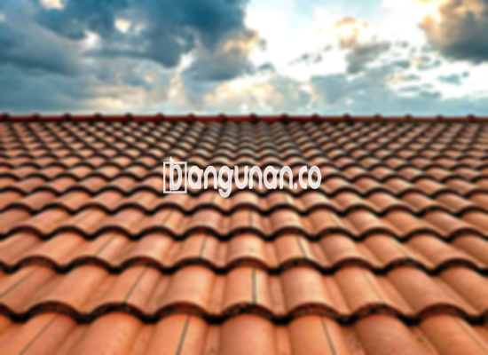

**Jual Genteng Kermaik & Beton di Kertamaya Bogor** – Membangun atau merenovasi rumah di Kertamaya Bogor membutuhkan material yang tepat, dan genteng adalah salah satu komponen terpenting. Genteng tidak hanya melindungi hunian Anda dari hujan dan panas terik, tetapi juga memberikan karakter estetika pada bangunan. Bagi Mitra Bangunan di Kertamaya Bogor yang membutuhkan solusi atap berkualitas, kami hadir sebagai penyedia genteng terpercaya.

Memilih genteng yang sesuai dengan kebutuhan dan anggaran Anda adalah keputusan penting. Terdapat beragam jenis genteng yang tersedia di pasaran, masing-masing dengan keunggulan dan kekurangannya tersendiri. Kami akan membantu Anda memahami perbedaan antara jenis-jenis genteng agar Anda dapat membuat pilihan yang paling tepat untuk rumah Anda.



## Informasi Harga Genteng dari Toko Jual Genteng Kermaik & Beton di Kertamaya Bogor

Pasar material bangunan menawarkan beragam pilihan genteng dengan rentang harga yang bervariasi. Berikut adalah gambaran umum tentang harga beberapa jenis genteng yang populer di Kertamaya Bogor. Untuk informasi harga terkini dan detail lebih lanjut, silakan hubungi tim kami.

### \- Harga Genteng Metal di Toko Genteng Kermaik & Beton di Kertamaya Bogor

Genteng metal menjadi favorit banyak orang karena ringan, kuat, dan tahan lama. Bentuknya yang modern sangat cocok untuk desain rumah minimalis. Genteng metal menawarkan tampilan yang elegan dan perawatan yang mudah.

### \- Harga Genteng Aspal di Toko Genteng Kermaik & Beton di Kertamaya Bogor

Genteng aspal dikenal karena keindahan estetikanya dan kemampuannya memberikan isolasi yang baik. Terbuat dari serat kayu dan aspal, genteng ini menawarkan ketahanan terhadap api dan cuaca ekstrem. Genteng aspal sering dipilih untuk menciptakan tampilan rumah yang klasik dan nyaman.

### \- Harga Genteng Kermaik & Beton di Kertamaya Bogor

Genteng keramik dan beton adalah pilihan populer karena keawetan dan variasi desainnya. Tersedia dalam berbagai warna dan tekstur, genteng ini memungkinkan Anda untuk menciptakan tampilan atap yang unik sesuai dengan gaya arsitektur rumah Anda.

### \- Harga Genteng Kaca di Toko Genteng Kermaik & Beton di Kertamaya Bogor

Genteng kaca umumnya digunakan sebagai aksen untuk memberikan pencahayaan alami pada ruangan di bawahnya. Meskipun tidak ideal sebagai penutup atap utama karena dapat menghasilkan panas, genteng kaca memberikan sentuhan artistik pada desain eksterior rumah Anda.

### \- Harga Genteng Seng di Toko Genteng Kermaik & Beton di Kertamaya Bogor

Genteng seng merupakan pilihan ekonomis yang sering digunakan pada bangunan tradisional. Dengan ukuran yang relatif panjang, genteng seng dapat menghemat biaya pemasangan. Untuk memastikan kekuatannya, pastikan genteng seng dipasang dengan paku yang kuat dan tahan karat.

### \- Harga Genteng Beton di Toko Genteng Kermaik & Beton di Kertamaya Bogor

Genteng beton menawarkan kombinasi ideal antara kekuatan, daya tahan, dan estetika. Terbuat dari campuran semen, pasir, dan air, genteng beton mampu menahan beban berat dan tahan terhadap cuaca ekstrem.



## Berbagai Jenis Genteng dari Toko Jual Genteng Kermaik & Beton di Kertamaya Bogor

Kami menyediakan berbagai jenis genteng untuk memenuhi kebutuhan spesifik Anda:

### Genteng Keramik dari Toko Jual Genteng Kermaik & Beton di Kertamaya Bogor

Genteng keramik adalah pilihan yang populer karena keindahan dan ketahanannya. Genteng ini memberikan perlindungan unggul terhadap panas matahari dan cuaca buruk, menjaga rumah Anda tetap sejuk dan nyaman.

### Genteng Seng dan Genteng Kermaik & Beton di Kertamaya Bogor

Genteng seng adalah pilihan klasik yang masih banyak digunakan hingga saat ini. Ukurannya yang panjang menjadikannya solusi yang hemat biaya, terutama untuk proyek-proyek dengan anggaran terbatas.

### Genteng Asbes dan Genteng Kermaik & Beton di Kertamaya Bogor

Genteng asbes dulu banyak digunakan karena harganya yang murah, namun saat ini kurang direkomendasikan karena masalah kesehatan dan lingkungan. Jika Anda mempertimbangkan genteng asbes, pastikan untuk mencari alternatif yang lebih aman dan ramah lingkungan.

### Genteng Kanopi Baja Ringan dan Genteng Kermaik & Beton di Kertamaya Bogor

Genteng kanopi baja ringan adalah pilihan modern dan praktis. Ringan, kuat, dan tahan lama, genteng ini ideal untuk berbagai jenis atap.

### Genteng Sirap Kayu Ulin dan Genteng Kermaik & Beton di Kertamaya Bogor

Genteng sirap kayu ulin memberikan tampilan alami dan elegan pada rumah Anda. Terbuat dari kayu ulin yang kuat dan tahan lama, genteng ini menawarkan keindahan yang abadi. Anda dapat memperoleh informasi lebih lanjut mengenai ragam Genteng Kermaik & Beton di Kertamaya Bogor sehingga tepat sasaran dengan kebutuhan bangunan Anda.

**Ref by:**  [Genteng Kermaik & Beton  Kertamaya Bogor](https://id.wikipedia.org/wiki/Genteng)

Bagi Anda, Mitra Bangunan, yang sedang mencari genteng berkualitas di Kertamaya Bogor, jangan ragu untuk menghubungi kami melalui tombol WhatsApp atau Telepon yang tersedia di halaman ini. Tim kami siap membantu Anda memilih genteng yang paling sesuai dengan kebutuhan dan anggaran Anda. Kami berkomitmen untuk memberikan pelayanan terbaik dan memastikan kepuasan Anda.