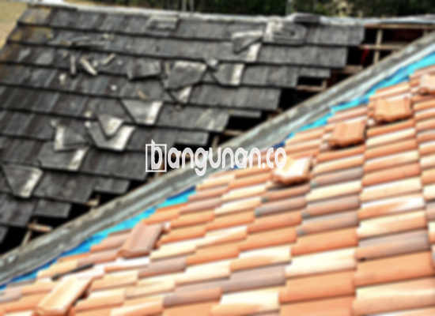

**Jual Genteng Kermaik & Beton di Kiara Pedes Purwakarta** – Genteng merupakan salah satu material rumah yang sangat penting untuk dimiliki setiap pemilik hunian. Dengan genteng yang tepat, bangunan Anda terlindungi dari berbagai kondisi cuaca dan tampil lebih menarik. Mitra Bangunan hadir di Kiara Pedes Purwakarta untuk menyediakan berbagai pilihan genteng berkualitas tinggi yang sesuai dengan kebutuhan Anda. Kami memahami pentingnya atap yang kuat dan tahan lama, dan siap membantu Anda menemukan solusi terbaik untuk rumah impian Anda.

Memilih genteng yang tepat adalah investasi penting untuk kenyamanan dan keamanan jangka panjang rumah Anda. Genteng berfungsi sebagai perlindungan utama dari hujan, panas matahari, dan angin kencang. Tanpa genteng yang memadai, rumah Anda rentan terhadap kerusakan dan kebocoran. Oleh karena itu, sangat penting untuk memilih material yang berkualitas dan sesuai dengan desain rumah Anda.



## Informasi Harga Genteng dari Toko Jual Genteng Kermaik & Beton di Kiara Pedes Purwakarta

Ada banyak sekali jenis genteng yang bisa Anda pilih, masing-masing dengan karakteristik dan harga yang berbeda. Untuk membantu Anda merencanakan anggaran, kami menyediakan informasi perkiraan harga beberapa jenis genteng yang populer di toko kami di Kiara Pedes Purwakarta.

### Harga Genteng Metal di Toko Genteng Kermaik & Beton di Kiara Pedes Purwakarta

Genteng metal adalah pilihan yang sangat populer karena ringan, kuat, dan terjangkau. Sering digunakan untuk rumah-rumah dengan desain modern dan minimalis, genteng metal memberikan tampilan yang bersih dan elegan. Untuk mengetahui harga genteng metal terbaru, Anda dapat merujuk ke tabel harga atau menghubungi tim kami untuk konsultasi lebih lanjut.

### Harga Genteng Aspal di Toko Genteng Kermaik & Beton di Kiara Pedes Purwakarta

Genteng aspal menawarkan kombinasi antara daya tahan, estetika, dan kemampuan meredam suara. Terbuat dari serat kayu dan aspal, material ini tahan terhadap cuaca ekstrem dan memberikan tampilan yang menarik. Anda dapat menemukan informasi harga genteng aspal yang terbaru melalui tabel yang ada atau dengan menghubungi kami secara langsung.

### Harga Genteng Keramik & Beton di Kiara Pedes Purwakarta

Genteng keramik dan beton adalah pilihan klasik yang hingga kini masih banyak diminati. Kedua jenis genteng ini menawarkan ketahanan yang baik terhadap cuaca dan tersedia dalam berbagai pilihan warna dan desain. Harga genteng keramik dan beton bervariasi tergantung pada ukuran, ketebalan, dan desainnya. Cek tabel harga kami atau hubungi kami untuk informasi lebih detail.

### Harga Genteng Kaca di Toko Genteng Kermaik & Beton di Kiara Pedes Purwakarta

Genteng kaca sering digunakan sebagai aksen dekoratif untuk memberikan efek pencahayaan alami pada ruangan. Namun, karena tidak memberikan perlindungan yang cukup terhadap panas dan hujan, genteng kaca umumnya tidak digunakan sebagai penutup atap utama. Anda bisa menemukan informasi harga genteng kaca terbaru di tabel harga yang kami sediakan.

### Harga Genteng Seng di Toko Genteng Kermaik & Beton di Kiara Pedes Purwakarta

Genteng seng merupakan pilihan ekonomis yang sering digunakan untuk bangunan sederhana atau sebagai alternatif yang terjangkau. Meskipun ringan, genteng seng perlu dipasang dengan benar untuk memastikan kekuatan dan ketahanannya. Kami menyediakan genteng seng berkualitas dengan harga yang kompetitif.

### Harga Genteng Beton di Toko Genteng Kermaik & Beton di Kiara Pedes Purwakarta

Genteng beton adalah pilihan yang kuat dan tahan lama untuk atap rumah Anda. Terbuat dari campuran semen, pasir, dan air berkualitas tinggi, genteng beton mampu menahan berbagai kondisi cuaca ekstrem. Anda dapat melihat harga genteng beton terbaru di tabel harga atau dengan menghubungi tim kami.



## Ragam Jenis Genteng dari Toko Jual Genteng Kermaik & Beton di Kiara Pedes Purwakarta

Berikut adalah beberapa jenis genteng yang tersedia di toko kami di Kiara Pedes Purwakarta, yang masing-masing memiliki keunggulan dan karakteristik unik:

### Genteng Keramik dari Toko Jual Genteng Kermaik & Beton di Kiara Pedes Purwakarta

Genteng keramik adalah pilihan yang populer karena keindahan dan ketahanannya. Dengan berbagai pilihan warna, bentuk, dan desain, Anda dapat menciptakan tampilan atap yang unik dan menarik untuk rumah Anda. Jika Anda mencari genteng dengan tampilan klasik dan elegan, genteng keramik adalah pilihan yang tepat.

### Genteng Seng dan Genteng Kermaik & Beton di Kiara Pedes Purwakarta

Genteng seng sering digunakan untuk bangunan sederhana karena harganya yang terjangkau dan ringan. Meskipun kurang tahan lama dibandingkan jenis genteng lainnya, genteng seng tetap menjadi pilihan yang populer untuk proyek-proyek dengan anggaran terbatas. Pastikan Anda memasang genteng seng dengan benar untuk memastikan kekuatan dan ketahanannya.

### Genteng Asbes dan Genteng Kermaik & Beton di Kiara Pedes Purwakarta

Genteng asbes, meskipun dahulu banyak digunakan, kini kurang direkomendasikan karena masalah kesehatan dan lingkungan. Genteng asbes rentan terhadap kerusakan dan dapat melepaskan serat berbahaya ke udara. Kami menyarankan Anda untuk mempertimbangkan alternatif lain yang lebih aman dan ramah lingkungan.

### Genteng Kanopi Baja Ringan dan Genteng Kermaik & Beton di Kiara Pedes Purwakarta

Genteng kanopi baja ringan adalah pilihan yang modern dan praktis untuk atap rumah Anda. Bahan ini ringan, kuat, dan tahan terhadap karat. Cocok untuk berbagai jenis desain rumah, genteng baja ringan memberikan perlindungan yang baik terhadap cuaca ekstrem.

### Genteng Sirap Kayu Ulin dan Genteng Kermaik & Beton di Kiara Pedes Purwakarta

Genteng sirap kayu ulin memberikan tampilan yang alami dan tradisional pada atap rumah Anda. Terbuat dari kayu ulin yang kuat dan tahan lama, jenis genteng ini menawarkan keindahan dan kehangatan yang unik. Jika Anda menginginkan tampilan atap yang berbeda dan berkarakter, genteng sirap kayu ulin adalah pilihan yang tepat.  [Jual Genteng Kermaik & Beton di Campaka Purwakarta](/jual-genteng-kermaik-beton-di-campaka-purwakarta/) menawarkan pilihan serupa untuk kebutuhan Anda.

Anda dapat menemukan beragam pilihan Genteng Kermaik & Beton di Kiara Pedes Purwakarta yang sesuai dengan preferensi Anda. Silakan tentukan jumlah yang dibutuhkan, material genteng yang diinginkan, dan desain yang paling Anda sukai. Mitra Bangunan siap membantu Anda mewujudkan atap impian Anda. Hubungi kami segera untuk mendapatkan penawaran harga terbaik dan layanan yang profesional.

**Ref by:**  [Genteng Kermaik & Beton  Kiara Pedes Purwakarta](https://id.wikipedia.org/wiki/Genteng)