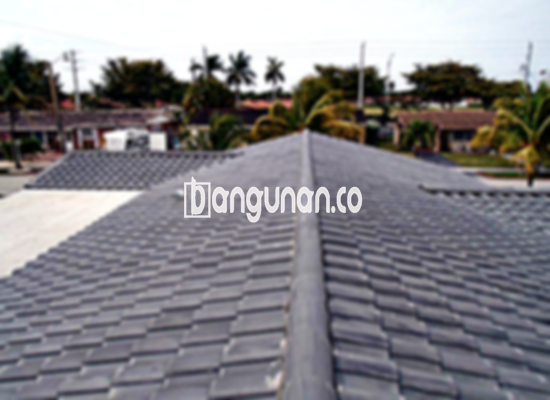

**Jual Genteng Kermaik & Beton di Klari Karawang** – Genteng adalah elemen material konstruksi yang sangat penting bagi setiap pemilik rumah. Melindungi hunian Anda dari hujan deras, terik matahari, dan berbagai elemen cuaca lainnya adalah fungsi utama genteng. Dengan memilih genteng yang tepat, Mitra Bangunan dapat memastikan kenyamanan dan keamanan rumah di Klari Karawang. Investasi dalam genteng berkualitas adalah langkah cerdas untuk jangka panjang.

Memilih jenis genteng yang ideal memerlukan pertimbangan matang. Ada berbagai opsi yang tersedia, masing-masing dengan karakteristik khasnya. Memahami kelebihan dan kekurangan setiap jenis akan membantu Anda membuat keputusan yang tepat sesuai dengan kebutuhan dan anggaran.



## Informasi Harga Genteng dari Toko Jual Genteng Kermaik & Beton di Klari Karawang

Untuk membantu Anda merencanakan anggaran proyek Anda, kami menyajikan informasi harga berbagai jenis genteng yang tersedia di toko kami di Klari Karawang. Harga dapat bervariasi tergantung pada merek, kualitas, dan jumlah yang dipesan. Kami selalu berusaha menawarkan harga yang kompetitif dan transparan kepada pelanggan setia kami.

### Harga Genteng Metal di Toko Genteng Kermaik & Beton di Klari Karawang

Genteng metal adalah solusi modern dan praktis untuk atap rumah Anda. Ringan, kuat, dan tahan lama, genteng ini sangat ideal untuk berbagai desain arsitektur. Desainnya yang ramping dan modern memberikan tampilan estetis pada bangunan Anda.

### Harga Genteng Aspal di Toko Genteng Kermaik & Beton di Klari Karawang

Jika Anda menginginkan tampilan atap yang elegan dan klasik, genteng aspal adalah pilihan yang tepat. Terbuat dari serat kayu dan aspal berkualitas tinggi, genteng ini menawarkan ketahanan terhadap cuaca ekstrem dan kemampuan meredam suara.

### Harga Genteng Kermaik & Beton di Klari Karawang

Genteng keramik dan beton adalah pilihan populer karena daya tahan dan karakteristik estetisnya. Tersedia dalam berbagai warna, tekstur, dan desain, Anda dapat menemukan genteng yang sesuai dengan gaya rumah Anda. Material ini juga memiliki sifat insulasi yang baik, membantu menjaga suhu dalam ruangan tetap nyaman.

### Harga Genteng Kaca di Toko Genteng Kermaik & Beton di Klari Karawang

Genteng kaca sering digunakan sebagai aksen dekoratif untuk menciptakan tampilan yang unik dan menarik. Dengan membiarkan cahaya alami masuk, genteng ini dapat memberikan kesan ruangan yang lebih terang dan luas. Perlu diingat bahwa genteng kaca mungkin tidak memberikan isolasi termal yang optimal.

### Harga Genteng Seng di Toko Genteng Kermaik & Beton di Klari Karawang

Genteng seng adalah pilihan ekonomis yang sering digunakan pada bangunan tradisional atau sederhana. Ukurannya yang panjang memungkinkan pemasangan yang lebih cepat dan efisien. Pemasangan yang benar dan penggunaan paku berkualitas penting untuk memastikan kekuatan dan ketahanan genteng seng.

### Harga Genteng Beton di Toko Genteng Kermaik & Beton di Klari Karawang

Genteng beton adalah solusi yang kokoh dan tahan lama untuk atap rumah Anda. Terbuat dari campuran semen, pasir, dan air, genteng ini memiliki kekuatan struktural yang tinggi dan tahan terhadap berbagai kondisi cuaca. Anda dapat memilih berbagai bentuk dan warna genteng beton untuk menciptakan tampilan atap yang sesuai dengan selera Anda.



## Berbagai Pilihan Jenis Genteng dari Toko Jual Genteng Kermaik & Beton di Klari Karawang

Kami menyediakan berbagai jenis genteng untuk memenuhi kebutuhan konstruksi dan renovasi Anda di Klari Karawang. Pilihan yang beragam ini memungkinkan Anda untuk menyesuaikan atap rumah dengan gaya arsitektur dan anggaran yang tersedia.

### Genteng Keramik dari Toko Jual Genteng Kermaik & Beton di Klari Karawang

Genteng keramik menawarkan kombinasi ideal antara keindahan, kekuatan, dan daya tahan. Dengan berbagai pilihan warna dan desain, Anda dapat menciptakan tampilan atap yang unik dan berkarakter. Genteng keramik juga membantu menjaga suhu dalam ruangan tetap sejuk, meningkatkan kenyamanan hunian Anda.

### Genteng Seng dan Genteng Kermaik & Beton di Klari Karawang

Genteng seng merupakan solusi yang ekonomis dan praktis untuk proyek pembangunan Anda. Dengan ukuran yang relatif panjang, pemasangan genteng seng dapat menghemat waktu dan biaya. Pastikan genteng seng dipasang dengan benar dan menggunakan paku berkualitas untuk memastikan kekuatannya.

### Genteng Asbes dan Genteng Kermaik & Beton di Klari Karawang

Meskipun ringan dan murah, penggunaan genteng asbes semakin dibatasi karena masalah kesehatan yang terkait dengan serat asbes. Pertimbangkan alternatif lain yang lebih aman dan ramah lingkungan untuk hunian Anda di Klari Karawang.

### Genteng Kanopi Baja Ringan dan Genteng Kermaik & Beton di Klari Karawang

Genteng kanopi baja ringan menawarkan kombinasi unik antara kekuatan, ringan, dan estetika modern. Material ini tahan terhadap karat, api, dan berbagai kondisi cuaca ekstrem, menjadikannya pilihan yang ideal untuk iklim Indonesia.

### Genteng Sirap Kayu Ulin dan Genteng Kermaik & Beton di Klari Karawang

Genteng sirap kayu ulin memberikan tampilan alami dan elegan pada atap rumah Anda. Terbuat dari kayu ulin berkualitas tinggi, genteng ini tahan terhadap cuaca ekstrem dan memiliki daya tahan yang baik. Anda dapat menikmati keindahan alami dan kehangatan yang ditawarkan oleh genteng sirap kayu ulin.

Anda dapat mempercayakan kebutuhan genteng Anda kepada kami di Klari Karawang. Kami menyediakan berbagai pilihan bahan, ukuran, dan warna untuk memenuhi semua kebutuhan Anda. Mitra Bangunan, hubungi kami sekarang melalui tombol WhatsApp atau Telepon di halaman ini untuk mendapatkan penawaran terbaik dan layanan konsultasi gratis.

**Ref by:**  [Genteng Kermaik & Beton  Klari Karawang](https://id.wikipedia.org/wiki/Genteng)