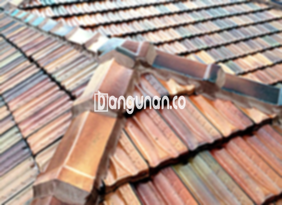

**Jual Genteng Keramik & Beton di Klaten** – Membangun atau merenovasi rumah di Klaten membutuhkan material yang tepat, dan genteng adalah salah satu komponen terpenting. Mitra Bangunan hadir sebagai solusi kebutuhan atap Anda, menyediakan berbagai pilihan genteng berkualitas untuk hunian yang aman dan nyaman. Genteng bukan hanya pelindung rumah dari cuaca, tetapi juga penentu estetika bangunan.

Investasi pada genteng berkualitas akan memberikan ketenangan pikiran dan perlindungan jangka panjang bagi keluarga Anda. Ada beragam jenis genteng yang bisa Anda pilih, masing-masing dengan kelebihan dan kekurangannya sendiri. Memilih yang tepat akan sangat bergantung pada preferensi dan kebutuhan spesifik Anda.



## Harga Genteng dari Toko Jual Genteng Keramik & Beton di Klaten

Kami menyediakan beragam pilihan genteng untuk memenuhi kebutuhan anggaran dan desain rumah Anda di Klaten. Berikut adalah beberapa referensi harga berdasarkan jenis genteng yang tersedia: 

### – Harga Genteng Metal di Toko Genteng Keramik & Beton di Klaten

Genteng metal adalah pilihan populer karena ringan, kuat, dan tahan lama. Material ini sangat cocok untuk desain rumah minimalis modern. Tampilannya yang ramping dan bersih akan memberikan sentuhan estetika yang menarik pada bangunan Anda.

### – Harga Genteng Aspal di Toko Genteng Kermaik & Beton di Klaten

Genteng aspal menawarkan tampilan yang elegan dan klasik. Terbuat dari serat kayu dan aspal, genteng ini dikenal karena daya tahannya terhadap api dan kemampuannya dalam meredam suara. Fleksibilitasnya juga menjadikannya pilihan yang baik untuk berbagai desain atap.

### – Harga Genteng Keramik & Beton di Klaten

Genteng keramik dan beton adalah pilihan yang paling umum digunakan di Indonesia. Keduanya menawarkan keunggulan dalam hal kekuatan, ketahanan, dan keindahan. Variasi warna dan desain yang beragam memungkinkan Anda untuk menyesuaikan tampilan atap dengan gaya rumah Anda.

### – Harga Genteng Kaca di Toko Genteng Kermaik & Beton di Klaten

Genteng kaca sering digunakan sebagai aksen untuk memberikan pencahayaan alami pada ruangan di bawahnya. Karena sifatnya yang tembus cahaya, genteng kaca biasanya digunakan dalam jumlah terbatas dan dikombinasikan dengan jenis genteng lainnya.

### – Harga Genteng Seng di Toko Genteng Kermaik & Beton di Klaten

Genteng seng merupakan pilihan ekonomis yang sering digunakan untuk bangunan sederhana atau rumah tradisional. Ukurannya yang lebih panjang dapat menghemat biaya pemasangan. Pastikan pemasangan dilakukan dengan benar menggunakan paku untuk memastikan kekuatan dan ketahanan.

### – Harga Genteng Beton di Toko Genteng Kermaik & Beton di Klaten

Genteng beton terkenal karena kekuatannya dan ketahanannya terhadap berbagai cuaca. Terbuat dari campuran semen, pasir, dan air, genteng beton adalah investasi jangka panjang yang andal untuk melindungi rumah Anda di Klaten.



## Jenis-jenis Genteng dari Toko Jual Genteng Keramik & Beton di Klaten

Anda akan menemukan berbagai pilihan genteng yang dapat disesuaikan dengan gaya dan anggaran Anda. Berikut beberapa jenis genteng yang tersedia:

### Genteng Keramik dari Toko Jual Genteng Kermaik & Beton di Klaten

Genteng keramik adalah pilihan populer karena menawarkan kombinasi keindahan, daya tahan, dan harga yang terjangkau. Warna dan desain yang bervariasi memungkinkan Anda menciptakan tampilan atap yang unik dan sesuai dengan selera Anda.  Genteng keramik juga efektif dalam melindungi rumah dari panas matahari.

### Genteng Seng dan Genteng Kermaik & Beton di Klaten

Genteng seng adalah solusi ekonomis yang sering digunakan pada bangunan tradisional. Ukurannya yang panjang membuat pemasangan lebih efisien dan hemat biaya. Penggunaan paku yang tepat akan memastikan genteng seng terpasang dengan kuat dan tahan lama.

### Genteng Asbes dan Genteng Kermaik & Beton di Klaten

Meskipun dahulu populer, genteng asbes kini kurang direkomendasikan karena masalah kesehatan dan lingkungan. Material ini rentan terhadap kerusakan dan memerlukan penggantian secara berkala.

### Genteng Kanopi Baja Ringan dan Genteng Kermaik & Beton di Klaten

Genteng kanopi baja ringan menawarkan kombinasi kekuatan, ringan, dan tampilan yang modern. Material ini sangat cocok untuk berbagai desain atap dan memberikan perlindungan yang baik terhadap cuaca ekstrem.

### Genteng Sirap Kayu Ulin dan Genteng Kermaik & Beton di Klaten

Genteng sirap kayu ulin memberikan kesan alami dan tradisional pada bangunan Anda. Terbuat dari kayu ulin yang berkualitas, genteng ini tahan terhadap cuaca dan memberikan isolasi termal yang baik.

Anda dapat menemukan berbagai jenis Genteng Kermaik & Beton di Klaten yang sesuai dengan kebutuhan Anda. Tentukan jumlah, bahan, dan jenis genteng yang diperlukan, dan kami siap membantu Anda. Hubungi kami segera untuk mendapatkan penawaran harga terbaik.

**Ref by:**  [Genteng Kermaik & Beton  Klaten](https://id.wikipedia.org/wiki/Genteng)

Mitra Bangunan siap melayani kebutuhan genteng Anda di Klaten. Jangan ragu untuk menghubungi kami melalui tombol WhatsApp atau Telepon di halaman ini untuk konsultasi dan pemesanan. Kami berkomitmen untuk memberikan solusi atap terbaik untuk rumah impian Anda.