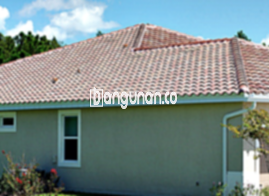

**Jual Genteng Kermaik & Beton di Klender Jakarta** – Mencari solusi atap yang tahan lama dan estetik? Mitra Bangunan di Klender Jakarta hadir sebagai penyedia genteng berkualitas tinggi yang akan melindungi hunian Anda dari berbagai kondisi cuaca. Genteng bukan hanya pelindung rumah, melainkan juga penentu tampilan visual yang mempercantik bangunan Anda. Rumah tanpa genteng yang tepat tentu akan terasa kurang nyaman dan rentan terhadap kerusakan.

Memilih genteng yang tepat adalah investasi jangka panjang untuk kenyamanan dan keamanan tempat tinggal Anda. Ada beragam jenis genteng yang tersedia, masing-masing dengan keunggulan dan kekurangannya tersendiri. Setiap orang memiliki preferensi unik dalam memilih genteng yang sesuai dengan gaya dan kebutuhan rumah mereka. Mengingat rumah adalah tempat tinggal yang digunakan dalam waktu lama, banyak yang mengutamakan kualitas dan ketahanan genteng.



## Harga Genteng dari Toko Jual Genteng Kermaik & Beton di Klender Jakarta

Berbagai pilihan genteng tersedia untuk memenuhi kebutuhan dan anggaran Anda. Setiap jenis genteng memiliki keunggulan masing-masing. Berikut adalah perkiraan harga beberapa jenis genteng yang bisa Anda pertimbangkan:

### - Harga Genteng Metal di Toko Genteng Kermaik & Beton di Klender Jakarta

Genteng metal banyak dipilih karena tampilannya yang modern dan elegan. Jenis genteng ini sering digunakan pada rumah minimalis, memberikan kesan rapi dan stylish. Bagi Anda yang mencari tampilan yang sleek dan terjangkau, genteng metal adalah pilihan yang tepat.

### - Harga Genteng Aspal di Toko Genteng Kermaik & Beton di Klender Jakarta

Genteng aspal menawarkan keunggulan dalam fleksibilitas dan kekuatan. Terbuat dari serat kayu dan aspal, material ini tahan terhadap cuaca ekstrem dan memiliki sifat anti-api yang baik. Jika Anda mencari genteng yang aman dan tahan lama, genteng aspal dapat menjadi solusi terbaik.

### - Harga Genteng Kermaik & Beton di Klender Jakarta

Genteng keramik dan beton adalah pilihan klasik yang populer karena keawetannya dan tampilan yang beragam. Dengan pilihan warna dan desain yang unik, Anda dapat menciptakan tampilan atap yang sesuai dengan gaya rumah Anda. Genteng ini juga dikenal karena kemampuannya menjaga suhu ruangan tetap stabil.

### - Harga Genteng Kaca di Toko Genteng Kermaik & Beton di Klender Jakarta

Genteng kaca umumnya digunakan sebagai aksen untuk memberikan pencahayaan alami pada ruangan. Meskipun tidak diaplikasikan secara keseluruhan pada atap, genteng kaca dapat memperindah tampilan atap rumah Anda dan menciptakan suasana yang lebih terang dan cerah.

### - Harga Genteng Seng di Toko Genteng Kermaik & Beton di Klender Jakarta

Genteng seng adalah pilihan ekonomis yang sering digunakan pada bangunan tradisional atau rumah dengan anggaran terbatas. Dengan ukurannya yang panjang dan harga yang terjangkau, genteng seng dapat menjadi solusi praktis untuk kebutuhan atap Anda.

### - Harga Genteng Beton di Toko Genteng Kermaik & Beton di Klender Jakarta

Genteng beton terkenal karena kekuatannya dan ketahanannya terhadap cuaca. Terbuat dari campuran semen, pasir, dan air, genteng ini ideal untuk bangunan yang membutuhkan perlindungan ekstra. Pilihlah genteng beton berkualitas tinggi untuk memastikan atap rumah Anda tetap kokoh dan awet selama bertahun-tahun.



## Beberapa Variasi Genteng dari Toko Jual Genteng Kermaik & Beton di Klender Jakarta

Berikut adalah beberapa pilihan variasi genteng yang bisa Anda pertimbangkan untuk hunian Anda:

### Genteng Keramik dari Toko Jual Genteng Kermaik & Beton di Klender Jakarta

Genteng keramik merupakan pilihan yang sangat baik untuk rumah Anda. Dengan tampilan yang menarik dan manfaat yang beragam, genteng ini dapat meningkatkan nilai estetika dan fungsionalitas rumah Anda. Anda akan semakin nyaman dan terlindungi dengan penerapan jenis genteng yang satu ini.

### Genteng Seng dan Genteng Kermaik & Beton di Klender Jakarta

Genteng seng adalah pilihan klasik yang masih banyak digunakan hingga saat ini. Dengan ukurannya yang panjang dan harga yang terjangkau, genteng seng merupakan solusi yang hemat biaya untuk kebutuhan atap Anda. Pastikan pemasangan dilakukan dengan benar menggunakan paku agar tahan terhadap angin dan cuaca buruk.

### Genteng Asbes dan Genteng Kermaik & Beton di Klender Jakarta

Genteng asbes memiliki kekurangan dalam hal ketahanan dan keamanan. Material yang mudah rusak dapat menyebabkan kebocoran dan memerlukan penggantian yang sering. Sebaiknya pertimbangkan jenis genteng lain yang lebih awet dan ramah lingkungan.

### Genteng Kanopi Baja Ringan dan Genteng Kermaik & Beton di Klender Jakarta

Genteng kanopi baja ringan menawarkan kombinasi antara kekuatan, fleksibilitas, dan desain yang unik. Jenis genteng ini cocok untuk berbagai jenis atap dan memberikan tampilan yang modern dan menarik.

### Genteng Sirap Kayu Ulin dan Genteng Kermaik & Beton di Klender Jakarta

Genteng sirap kayu ulin adalah pilihan yang memberikan kesan alami dan tradisional pada rumah Anda. Terbuat dari kayu ulin yang tahan lama, jenis genteng ini menawarkan kehangatan dan keindahan yang unik.

Anda dapat memilih variasi Genteng Kermaik & Beton di Klender Jakarta yang sesuai dengan selera Anda, dengan mempertimbangkan jumlah, bahan, dan jenis genteng yang diperlukan. Untuk mendapatkan penawaran harga dan informasi lebih lanjut, hubungi kami segera untuk berkonsultasi dengan tim ahli kami. Mitra Bangunan siap membantu Anda menemukan solusi atap terbaik untuk rumah impian Anda.

**Ref by:**  [Genteng Kermaik & Beton  Klender Jakarta](https://id.wikipedia.org/wiki/Genteng)