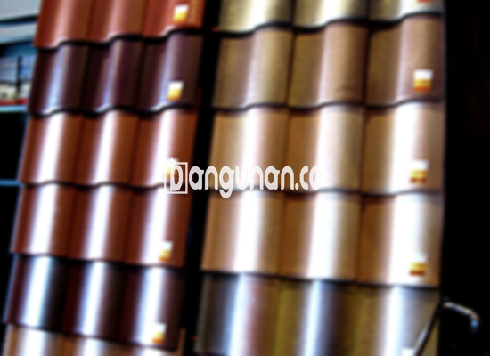

**Jual Genteng Kermaik & Beton di Koja Jakarta** – Membangun atau merenovasi rumah di Koja Jakarta membutuhkan material berkualitas, dan genteng adalah salah satu yang terpenting. Genteng bukan hanya pelindung rumah dari cuaca ekstrem, tetapi juga penentu estetika bangunan Anda. Mitra Bangunan hadir sebagai solusi lengkap untuk kebutuhan genteng, menawarkan berbagai pilihan dengan harga kompetitif dan pengiriman gratis. 

Penting bagi Anda untuk memilih genteng yang tepat sesuai kebutuhan dan anggaran. Ada beragam jenis genteng yang tersedia di pasaran, masing-masing dengan keunggulan dan kekurangannya sendiri. Pertimbangkan gaya arsitektur rumah Anda dan iklim di Koja Jakarta saat memilih jenis genteng yang paling sesuai. Dengan mempertimbangkan faktor-faktor ini, Anda dapat memastikan investasi terbaik untuk kenyamanan dan keamanan hunian Anda.



## Informasi Harga Genteng dari Toko Jual Genteng Kermaik & Beton di Koja Jakarta

Untuk membantu Anda merencanakan anggaran, berikut adalah gambaran umum harga berbagai jenis genteng yang tersedia di toko kami di Koja Jakarta. Harga dapat bervariasi tergantung pada merek, kualitas, dan jumlah pesanan.

### - Harga Genteng Metal di Toko Genteng Kermaik & Beton di Koja Jakarta

Genteng metal adalah pilihan populer karena ringan, kuat, dan tahan lama. Sering digunakan pada rumah bergaya minimalis, genteng ini memberikan tampilan modern dan elegan. Untuk informasi harga terkini mengenai genteng metal, silakan lihat tabel harga di bawah atau hubungi tim kami.

### - Harga Genteng Aspal di Toko Genteng Kermaik & Beton di Koja Jakarta

Genteng aspal menawarkan tampilan yang menarik dan ketahanan yang baik terhadap cuaca. Terbuat dari serat kayu dan aspal, material ini memberikan isolasi termal yang baik dan tahan terhadap api. Anda dapat menemukan informasi mengenai harga genteng aspal di Koja Jakarta pada tabel harga berikut atau menghubungi kami langsung.

### - Harga Genteng Keramik & Beton di Koja Jakarta

Genteng keramik dan beton adalah pilihan klasik yang menawarkan keindahan dan daya tahan. Dengan berbagai pilihan warna dan desain, Anda dapat menemukan genteng yang sesuai dengan gaya arsitektur rumah Anda. Hubungi kami untuk mendapatkan informasi harga terbaru mengenai genteng keramik dan beton di Koja Jakarta.

### - Harga Genteng Kaca di Toko Genteng Kermaik & Beton di Koja Jakarta

Genteng kaca sering digunakan sebagai aksen dekoratif untuk memberikan pencahayaan alami pada ruangan. Namun, perlu diingat bahwa genteng kaca dapat meningkatkan suhu ruangan. Untuk mengetahui ketersediaan dan harga genteng kaca di Koja Jakarta, silakan hubungi kami.

### - Harga Genteng Seng di Toko Genteng Kermaik & Beton di Koja Jakarta

Genteng seng adalah pilihan ekonomis yang sering digunakan pada bangunan tradisional atau renovasi. Meskipun ringan dan terjangkau, genteng seng memerlukan perawatan rutin untuk mencegah karat. Periksa tabel harga atau hubungi kami untuk informasi lebih lanjut mengenai genteng seng di Koja Jakarta.

### - Harga Genteng Beton di Toko Genteng Kermaik & Beton di Koja Jakarta

Genteng beton adalah pilihan kuat dan tahan lama yang terbuat dari campuran semen, pasir, dan air. Material ini tahan terhadap cuaca ekstrem dan memberikan isolasi termal yang baik. Anda dapat menemukan informasi harga genteng beton di Koja Jakarta pada tabel harga di bawah atau hubungi tim kami.



## Berbagai Pilihan Genteng dari Toko Jual Genteng Kermaik & Beton di Koja Jakarta

Kami menyediakan beragam jenis genteng untuk memenuhi kebutuhan Anda, mulai dari genteng tradisional hingga modern. Berikut adalah beberapa pilihan yang tersedia:

### Genteng Keramik dari Toko Jual Genteng Kermaik & Beton di Koja Jakarta

Genteng keramik adalah pilihan populer karena keindahan dan daya tahannya. Dengan berbagai pilihan warna dan desain, Anda dapat menciptakan tampilan yang unik dan menarik untuk rumah Anda. Genteng keramik juga memberikan isolasi termal yang baik, menjaga rumah Anda tetap sejuk di cuaca panas.

### Genteng Seng dan Genteng Kermaik & Beton di Koja Jakarta

Genteng seng merupakan pilihan ekonomis yang cocok untuk proyek dengan anggaran terbatas. Meskipun ringan, genteng seng memerlukan perawatan rutin untuk mencegah karat. Jika Anda mempertimbangkan genteng seng, pastikan untuk menggunakan paku berkualitas tinggi untuk memastikan kekuatan dan stabilitas pemasangan.

### Genteng Asbes dan Genteng Kermaik & Beton di Koja Jakarta

Genteng asbes dulunya banyak digunakan karena harganya yang terjangkau. Namun, karena masalah kesehatan yang terkait dengan serat asbes, penggunaannya semakin dibatasi dan tidak direkomendasikan. Kami menyarankan untuk memilih alternatif yang lebih aman dan ramah lingkungan.

### Genteng Kanopi Baja Ringan dan Genteng Kermaik & Beton di Koja Jakarta

Genteng kanopi baja ringan menawarkan kombinasi kekuatan, ringan, dan estetika yang menarik. Ideal untuk berbagai gaya arsitektur, genteng ini tahan terhadap cuaca ekstrem dan memerlukan perawatan minimal. 

### Genteng Sirap Kayu Ulin dan Genteng Kermaik & Beton di Koja Jakarta

Genteng sirap kayu ulin memberikan tampilan tradisional dan alami yang menawan. Terbuat dari kayu ulin yang tahan lama, jenis genteng ini cocok untuk rumah dengan gaya klasik atau tropis. Anda dapat menemukan informasi harga dan ketersediaan genteng sirap kayu ulin di Koja Jakarta dengan menghubungi kami.

Anda dapat menemukan jenis Genteng Kermaik & Beton di Koja Jakarta yang paling sesuai dengan kebutuhan Anda dengan berkonsultasi dengan tim kami. Kami siap membantu Anda memilih material, menghitung kebutuhan, dan memberikan penawaran harga terbaik. Jangan ragu untuk menghubungi kami melalui tombol WhatsApp atau Telepon di halaman ini untuk mendapatkan layanan yang profesional dan ramah. Mitra Bangunan siap menjadi mitra terbaik Anda dalam membangun rumah impian di Koja Jakarta.

**Ref by:**  [Genteng Kermaik & Beton  Koja Jakarta](https://id.wikipedia.org/wiki/Genteng)