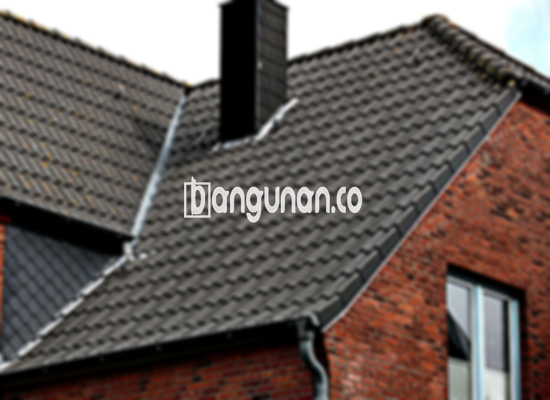

**Jual Genteng Kermaik & Beton di Kosambi Tangerang** – Genteng adalah salah satu material konstruksi yang sangat penting bagi setiap pemilik hunian. Perlindungan yang diberikan genteng terhadap berbagai cuaca, seperti hujan dan panas terik, sangatlah krusial untuk kenyamanan dan keamanan rumah Anda. Mitra Bangunan di Kosambi Tangerang menyediakan solusi atap terbaik dengan beragam pilihan genteng berkualitas tinggi yang akan memastikan rumah Anda terlindungi dengan baik. Dengan begitu, Anda dapat menikmati lingkungan tempat tinggal yang aman dan nyaman.

Memilih jenis genteng yang tepat adalah keputusan penting yang perlu dipertimbangkan dengan cermat. Banyak sekali ragam genteng yang tersedia di pasaran, masing-masing menawarkan karakteristik unik serta keunggulan dan kekurangan tersendiri. Pertimbangkan kebutuhan spesifik rumah Anda, gaya arsitektur yang diinginkan, dan anggaran yang tersedia untuk menemukan solusi yang paling sesuai. Investasi pada genteng berkualitas menjamin ketahanan dan keindahan atap hunian Anda.



## Informasi Harga Genteng dari Toko Jual Genteng Kermaik & Beton di Kosambi Tangerang

Berbagai macam jenis genteng dapat Anda gunakan untuk membangun atap impian Anda. Setiap jenis genteng memiliki kelebihan dan kekurangan masing-masing yang dapat disesuaikan dengan kebutuhan dan preferensi Anda. Berikut ini adalah referensi harga yang dapat Anda jadikan acuan:

### \- Harga Genteng Metal di Toko Genteng Kermaik & Beton di Kosambi Tangerang

Genteng metal merupakan salah satu pilihan yang paling banyak diminati karena kepraktisannya. Material ini sering digunakan dalam desain rumah modern minimalis, memberikan kesan elegan dan kontemporer. Karakteristik unggulnya meliputi bobot yang ringan, kekuatan yang mumpuni, serta kemudahan dalam proses pemasangan. Untuk informasi detail mengenai harga, Anda dapat merujuk pada tabel harga yang tersedia atau menghubungi tim penjualan kami.

### \- Harga Genteng Aspal di Toko Genteng Kermaik & Beton di Kosambi Tangerang

Genteng aspal adalah pilihan yang menawarkan kombinasi daya tahan dan estetika yang menarik. Terbuat dari serat kayu dan aspal berkualitas tinggi, material ini dikenal karena kemampuannya meredam suara dan tahan terhadap api. Dapatkan penawaran harga terbaik untuk genteng aspal di Kosambi Tangerang dengan menghubungi kami melalui layanan pelanggan.

### \- Harga Genteng Keramik & Beton di Kosambi Tangerang

Genteng keramik adalah pilihan klasik yang sangat populer di kalangan pemilik rumah karena daya tariknya yang timeless. Dengan berbagai pilihan warna dan desain yang menawan, genteng keramik dapat memberikan tampilan yang unik dan elegan pada atap rumah Anda. Informasi harga terbaru untuk genteng keramik dapat Anda temukan pada tabel harga yang telah kami sediakan.

### \- Harga Genteng Kaca di Toko Genteng Kermaik & Beton di Kosambi Tangerang

Genteng kaca seringkali digunakan sebagai elemen dekoratif untuk memberikan sentuhan unik pada bangunan. Penggunaan genteng kaca umumnya hanya sebagai aksen, karena dapat menyebabkan ruangan terasa lebih panas. Detail harga dan spesifikasi genteng kaca dapat Anda temukan pada tabel yang telah disediakan.

### \- Harga Genteng Seng di Toko Genteng Kermaik & Beton di Kosambi Tangerang

Genteng seng merupakan pilihan yang ekonomis dan sering digunakan pada bangunan tradisional atau rumah dengan anggaran terbatas. Ukurannya yang panjang membuat pemasangan menjadi lebih efisien dan menghemat biaya. Pastikan untuk menggunakan paku yang kuat agar genteng seng terpasang dengan aman dan tahan lama. Anda dapat menemukan informasi harga lengkapnya pada tabel yang telah kami siapkan.

### \- Harga Genteng Beton di Toko Genteng Kermaik & Beton di Kosambi Tangerang

Genteng beton merupakan pilihan yang tepat jika Anda mengutamakan kekuatan dan ketahanan. Terbuat dari campuran semen, pasir, dan air berkualitas tinggi, genteng beton memiliki daya tahan yang sangat baik terhadap cuaca ekstrem dan kerusakan. Banyak pemilik rumah lebih memilih genteng beton karena keawetannya dibandingkan jenis genteng lainnya. Silakan periksa tabel harga untuk mengetahui penawaran terbaik yang kami berikan.



## Beragam Pilihan Genteng dari Toko Jual Genteng Kermaik & Beton di Kosambi Tangerang

Berikut ini adalah beberapa jenis genteng yang dapat Anda pertimbangkan untuk proyek konstruksi Anda:

### Genteng Keramik dari Toko Jual Genteng Kermaik & Beton di Kosambi Tangerang

Jika Anda mencari genteng yang tahan lama dan memberikan tampilan estetis, genteng keramik adalah pilihan yang sangat tepat. Material ini menawarkan daya tahan tinggi terhadap perubahan cuaca serta membantu menjaga suhu ruangan tetap nyaman. Dengan beragam variasi warna dan desain yang tersedia, Anda dapat menyesuaikannya agar sesuai dengan gaya arsitektur rumah Anda.

### Genteng Seng dan Genteng Kermaik & Beton di Kosambi Tangerang

Genteng seng adalah pilihan tradisional yang masih banyak digunakan hingga saat ini karena harganya yang relatif terjangkau. Ukurannya yang panjang memungkinkan pemasangan yang lebih cepat dan efisien. Pastikan untuk menggunakan paku yang berkualitas tinggi agar genteng seng terpasang dengan kuat dan tidak mudah lepas.

### Genteng Asbes dan Genteng Kermaik & Beton di Kosambi Tangerang

Genteng asbes meskipun ringan, kurang direkomendasikan untuk digunakan karena sifatnya yang mudah rusak dan berpotensi menimbulkan risiko kesehatan. Material ini cenderung rentan terhadap retak dan memerlukan penggantian secara berkala. Kami sarankan Anda mempertimbangkan alternatif lain yang lebih tahan lama dan aman.

### Genteng Kanopi Baja Ringan dan Genteng Kermaik & Beton di Kosambi Tangerang

Genteng kanopi baja ringan adalah pilihan yang populer karena kombinasi kekuatan, keindahan, dan fleksibilitasnya. Material ini sangat cocok untuk berbagai jenis atap dan memberikan tampilan modern pada bangunan Anda. Keunggulannya terletak pada bobotnya yang ringan, kekuatan yang tinggi, dan ketahanannya terhadap korosi.

### Genteng Sirap Kayu Ulin dan Genteng Kermaik & Beton di Kosambi Tangerang

Genteng sirap kayu ulin menawarkan sentuhan alami dan unik pada bangunan Anda. Terbuat dari kayu ulin yang berkualitas tinggi, material ini memberikan tampilan yang hangat dan tahan lama. Harganya relatif terjangkau dan dapat memberikan perlindungan yang optimal bagi hunian Anda.

Anda dapat menemukan berbagai pilihan Genteng Kermaik & Beton di Kosambi Tangerang yang sesuai dengan preferensi dan anggaran Anda. Silakan tentukan jumlah yang dibutuhkan, material genteng yang diinginkan, serta jenis genteng yang paling cocok untuk rumah Anda dan hubungi kami untuk mendapatkan penawaran terbaik. Mitra Bangunan siap membantu Anda dalam mewujudkan atap impian Anda. Jangan ragu untuk menghubungi kami melalui tombol WhatsApp atau Telepon yang tersedia di halaman ini.

**Ref by:**  [Genteng Kermaik & Beton  Kosambi Tangerang](https://id.wikipedia.org/wiki/Genteng)