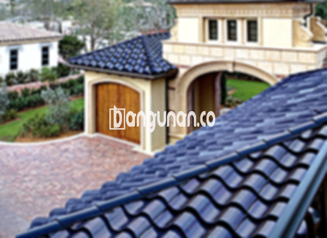

**Jual Genteng Kermaik & Beton di Kota Bambu Jakarta** – Genteng merupakan material penting dalam pembangunan rumah yang seharusnya dimiliki setiap pemilik hunian. Genteng berfungsi melindungi tempat tinggal Anda dari berbagai kondisi cuaca seperti hujan dan panas terik. Bagi Mitra Bangunan di Kota Bambu Jakarta, kami hadir untuk menyediakan solusi atap berkualitas tinggi yang akan meningkatkan keamanan dan kenyamanan hunian Anda. Investasi pada atap yang baik adalah investasi jangka panjang untuk ketenangan pikiran Anda.

Memilih genteng yang tepat adalah langkah krusial dalam membangun atau merenovasi rumah. Ada beragam jenis genteng yang tersedia di pasaran, masing-masing dengan karakteristik dan keunggulannya sendiri. Penting bagi Anda untuk mempertimbangkan kebutuhan spesifik rumah Anda, gaya arsitektur, serta anggaran yang tersedia sebelum membuat keputusan. Dengan perencanaan yang matang, Anda akan mendapatkan atap yang sesuai dengan harapan Anda.



## Informasi Harga Genteng dari Toko Jual Genteng Kermaik & Beton di Kota Bambu Jakarta

Kami menawarkan berbagai pilihan genteng dengan harga yang kompetitif. Setiap jenis genteng memiliki kisaran harga yang berbeda, tergantung pada kualitas material, proses pembuatan, dan fitur-fitur tambahan yang ditawarkan. Berikut adalah gambaran umum mengenai harga genteng yang tersedia di toko kami:

### Harga Genteng Metal di Toko Genteng Kermaik & Beton di Kota Bambu Jakarta

Genteng metal menjadi semakin populer karena ringan, kuat, serta tahan lama. Material ini juga menawarkan variasi desain yang menarik, sehingga cocok untuk berbagai gaya arsitektur, terutama desain minimalis dan modern. Untuk mengetahui harga terbaru genteng metal, Anda dapat merujuk pada tabel harga di bawah atau menghubungi tim kami.

### Harga Genteng Aspal di Toko Genteng Kermaik & Beton di Kota Bambu Jakarta

Genteng aspal adalah pilihan tepat bagi Anda yang menginginkan atap yang tahan air dan memiliki daya serap suara yang baik. Terbuat dari serat kayu dan aspal berkualitas tinggi, genteng ini menawarkan perlindungan optimal terhadap cuaca ekstrem. Untuk informasi harga genteng aspal yang lebih detail, silakan lihat tabel harga yang tersedia.

### Harga Genteng Kermaik & Beton di Kota Bambu Jakarta

Genteng keramik merupakan pilihan klasik yang tak lekang oleh waktu. Keindahan alami dan variasi warna yang kaya menjadikan genteng keramik sebagai pilihan favorit banyak orang. Selain estetikanya, genteng keramik juga dikenal tahan lama dan tidak mudah rusak. Detail harga genteng keramik dapat Anda temukan di tabel harga kami.

### Harga Genteng Kaca di Toko Genteng Kermaik & Beton di Kota Bambu Jakarta

Genteng kaca sering digunakan sebagai elemen dekoratif untuk menciptakan tampilan yang unik dan menarik. Meskipun tidak digunakan sebagai atap utama, genteng kaca dapat memberikan pencahayaan alami yang indah pada ruangan di bawahnya. Anda dapat melihat informasi harga genteng kaca pada tabel harga yang kami sediakan.

### Harga Genteng Seng di Toko Genteng Kermaik & Beton di Kota Bambu Jakarta

Genteng seng adalah pilihan ekonomis yang cocok untuk bangunan dengan anggaran terbatas. Material ini ringan, mudah dipasang, serta tahan terhadap korosi. Meskipun demikian, penting untuk memilih genteng seng berkualitas tinggi agar awet dan tidak mudah berkarat. Informasi harga genteng seng tersedia pada tabel harga di bawah.

### Harga Genteng Beton di Toko Genteng Kermaik & Beton di Kota Bambu Jakarta

Genteng beton adalah pilihan ideal bagi Anda yang mencari atap yang kuat, tahan lama, dan tahan terhadap cuaca ekstrem. Terbuat dari campuran semen, pasir, dan air berkualitas tinggi, genteng beton menawarkan perlindungan optimal bagi rumah Anda. Anda dapat menemukan detail harga genteng beton pada tabel harga yang tersedia.



## Ragam Pilihan Genteng dari Toko Jual Genteng Kermaik & Beton di Kota Bambu Jakarta

Kami menyediakan beragam pilihan genteng dengan berbagai karakteristik dan keunggulan. Berikut adalah beberapa jenis genteng yang dapat Anda pilih:

### Genteng Keramik dari Toko Jual Genteng Kermaik & Beton di Kota Bambu Jakarta

Genteng keramik adalah pilihan klasik yang menawarkan keindahan alami dan daya tahan yang baik. Material ini memberikan tampilan yang elegan dan berkelas pada rumah Anda, serta tahan terhadap panas dan hujan. Anda dapat memilih berbagai warna dan tekstur keramik untuk menyesuaikan dengan gaya arsitektur rumah Anda.

### Genteng Seng dan Genteng Kermaik & Beton di Kota Bambu Jakarta

Genteng seng merupakan pilihan ekonomis yang cocok untuk bangunan dengan anggaran terbatas. Material ini ringan, mudah dipasang, dan tahan terhadap korosi. Meskipun demikian, penting untuk memastikan kualitas seng yang digunakan agar tahan lama dan tidak mudah berkarat.

### Genteng Asbes dan Genteng Kermaik & Beton di Kota Bambu Jakarta

Genteng asbes adalah pilihan yang kurang direkomendasikan karena mengandung serat asbes yang dapat berbahaya bagi kesehatan. Material ini mudah pecah dan membutuhkan penggantian yang sering. Sebaiknya pertimbangkan alternatif lain yang lebih aman dan ramah lingkungan.

### Genteng Kanopi Baja Ringan dan Genteng Kermaik & Beton di Kota Bambu Jakarta

Genteng kanopi baja ringan adalah pilihan yang populer karena ringan, kuat, dan mudah dipasang. Material ini tahan terhadap korosi dan memiliki umur pakai yang panjang. Genteng kanopi baja ringan sangat cocok untuk rumah dengan desain modern dan minimalis.

### Genteng Sirap Kayu Ulin dan Genteng Kermaik & Beton di Kota Bambu Jakarta

Genteng sirap kayu ulin menawarkan keindahan alami dan ketahanan yang baik. Terbuat dari kayu ulin berkualitas tinggi, genteng ini tahan terhadap cuaca ekstrem dan memiliki tampilan yang unik dan berkelas. Pilihan ini cocok untuk Anda yang menginginkan tampilan rumah yang alami dan tradisional.

Sebagai Mitra Bangunan yang cerdas, Anda dapat mempercayakan kebutuhan atap Anda kepada kami. Kami menyediakan berbagai jenis genteng berkualitas tinggi dengan harga yang kompetitif. Jangan ragu untuk menghubungi kami melalui tombol WhatsApp atau Telepon di halaman ini untuk mendapatkan penawaran terbaik dan konsultasi gratis. Kami siap membantu Anda mewujudkan atap impian Anda.

**Ref by:**  [Genteng Kermaik & Beton  Kota Bambu Jakarta](https://id.wikipedia.org/wiki/Genteng)