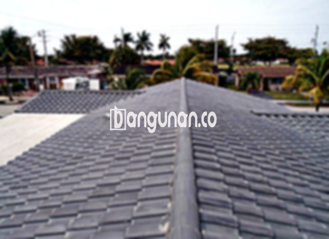

**Jual Genteng Kermaik & Beton di Kotabaru Karawang** – Genteng merupakan material bangunan yang sangat penting bagi setiap pemilik rumah. Bagi Mitra Bangunan di Kotabaru Karawang, memilih genteng yang tepat adalah langkah awal untuk menciptakan hunian yang nyaman dan terlindungi. Genteng berfungsi sebagai perlindungan utama dari berbagai kondisi cuaca, seperti hujan deras, terik matahari, dan angin kencang. Tanpa genteng yang berkualitas, rumah akan rentan terhadap kerusakan dan terasa kurang nyaman untuk ditinggali.

Investasi pada genteng berkualitas adalah keputusan bijak yang akan memberikan manfaat jangka panjang. Ada beragam jenis genteng yang tersedia di pasaran, masing-masing dengan karakteristik dan keunggulan tersendiri. Proses pemilihan genteng yang tepat memerlukan pertimbangan matang agar sesuai dengan kebutuhan, gaya arsitektur rumah, dan tentu saja, anggaran yang tersedia. Kami, sebagai penyedia solusi genteng terpercaya di Kotabaru Karawang, siap membantu Anda menemukan pilihan terbaik.



## Informasi Harga Genteng dari Toko Jual Genteng Kermaik & Beton di Kotabaru Karawang

Untuk membantu Anda dalam mengambil keputusan, berikut adalah daftar berbagai jenis genteng beserta perkiraan harganya. Informasi ini dapat menjadi acuan awal sebelum Anda berkonsultasi langsung dengan tim kami untuk mendapatkan penawaran yang lebih spesifik dan sesuai dengan kebutuhan Anda.

### - Harga Genteng Metal di Toko Genteng Kermaik & Beton di Kotabaru Karawang

Genteng metal menjadi semakin populer karena bobotnya yang ringan, tampilan modern, dan kemudahan pemasangannya. Genteng ini sangat cocok untuk desain rumah minimalis dan memberikan kesan yang bersih serta rapi. Jika Anda mencari solusi atap yang praktis dan estetis, genteng metal bisa menjadi pilihan yang tepat. Lihat tabel harga untuk detail lebih lanjut.

### - Harga Genteng Aspal di Toko Genteng Kermaik & Beton di Kotabaru Karawang

Genteng aspal menawarkan kombinasi unik antara kekuatan, fleksibilitas, dan tampilan yang menarik. Terbuat dari serat kayu dan aspal berkualitas tinggi, genteng ini memiliki daya tahan yang baik terhadap cuaca ekstrem dan api. Dengan memilih genteng aspal, Anda memberikan perlindungan optimal bagi hunian Anda. Cek informasi harga terbaru pada tabel harga yang tersedia.

### - Harga Genteng Kermaik & Beton di Kotabaru Karawang

Genteng keramik dan beton adalah pilihan klasik yang selalu menjadi favorit. Genteng keramik menawarkan variasi warna dan desain yang kaya, sementara genteng beton dikenal karena kekuatannya dan ketahanannya terhadap benturan. Kedua jenis ini merupakan investasi jangka panjang yang akan menjaga rumah Anda tetap terlindungi selama bertahun-tahun. Detail harga bisa Anda temukan di tabel harga.

### - Harga Genteng Kaca di Toko Genteng Kermaik & Beton di Kotabaru Karawang

Genteng kaca biasanya digunakan sebagai elemen dekoratif untuk memberikan sentuhan unik dan pencahayaan alami pada ruangan. Meskipun tidak cocok untuk menutupi seluruh atap karena dapat meningkatkan panas, genteng kaca dapat menciptakan suasana yang cerah dan menyenangkan di dalam rumah Anda. Informasi harga terbaru dapat dilihat di tabel harga.

### - Harga Genteng Seng di Toko Genteng Kermaik & Beton di Kotabaru Karawang

Genteng seng merupakan pilihan ekonomis yang sering digunakan pada bangunan tradisional. Dengan bentuknya yang panjang dan ringan, genteng seng menawarkan solusi praktis untuk atap rumah Anda. Pastikan untuk menggunakan paku yang sesuai agar pemasangan genteng seng lebih kuat dan tahan lama. Cek tabel harga untuk informasi lebih lanjut.

### - Harga Genteng Beton di Toko Genteng Kermaik & Beton di Kotabaru Karawang

Genteng beton dibuat dari campuran semen, pasir, dan air yang dipadatkan, menghasilkan material yang sangat kokoh dan tahan lama. Banyak pemilik rumah di Kotabaru Karawang memilih genteng beton karena kemampuannya menahan berbagai kondisi cuaca ekstrem dan memberikan perlindungan optimal bagi hunian mereka. Informasi harga terkini tersedia di tabel harga.



## Beberapa Jenis Genteng dari Toko Jual Genteng Kermaik & Beton di Kotabaru Karawang

Mari kita bahas lebih detail beberapa jenis genteng yang populer dan sering digunakan oleh para pemilik rumah di Kotabaru Karawang. Pilihan yang tepat akan sangat mempengaruhi tampilan dan fungsi atap rumah Anda.

### Genteng Keramik dari Toko Jual Genteng Kermaik & Beton di Kotabaru Karawang

Genteng keramik menawarkan estetika yang menawan dan memberikan sentuhan tradisional pada rumah Anda. Dengan berbagai pilihan warna dan desain, Anda dapat menemukan genteng keramik yang sesuai dengan gaya arsitektur rumah Anda. Genteng ini juga memberikan perlindungan yang baik terhadap panas matahari dan hujan.

### Genteng Seng dan Genteng Kermaik & Beton di Kotabaru Karawang

Genteng seng menawarkan solusi yang ekonomis dan ringan untuk atap rumah Anda. Dengan bentuknya yang panjang dan mudah dipasang, genteng ini menjadi pilihan populer bagi banyak orang. Pastikan Anda menggunakan paku yang kuat untuk memastikan genteng seng terpasang dengan aman dan tidak mudah bergeser.

### Genteng Asbes dan Genteng Kermaik & Beton di Kotabaru Karawang

Genteng asbes, meskipun dahulu populer, sekarang kurang direkomendasikan karena kurang tahan lama dan berpotensi membahayakan kesehatan. Material ini rentan terhadap kerusakan dan memerlukan penggantian yang lebih sering.

### Genteng Kanopi Baja Ringan dan Genteng Kermaik & Beton di Kotabaru Karawang

Genteng kanopi baja ringan adalah pilihan yang ringan, kuat, dan tahan terhadap karat. Genteng ini memberikan perlindungan yang baik terhadap cuaca ekstrem dan memberikan tampilan yang modern pada rumah Anda. Dengan bobotnya yang ringan, pemasangan genteng ini juga lebih mudah dan cepat.

### Genteng Sirap Kayu Ulin dan Genteng Kermaik & Beton di Kotabaru Karawang

Genteng sirap kayu ulin menawarkan keindahan alami dan kesan tradisional yang unik. Terbuat dari kayu ulin yang kuat dan tahan lama, genteng ini memberikan kehangatan dan kenyamanan pada hunian Anda. Anda akan merasakan suasana yang berbeda dan lebih alami dengan memilih genteng sirap kayu ulin.

Anda dapat menemukan beragam pilihan Genteng Kermaik & Beton di Kotabaru Karawang yang sesuai dengan kebutuhan dan anggaran Anda. Mitra Bangunan siap membantu Anda dalam memilih genteng yang tepat dan memberikan penawaran harga yang kompetitif. Jangan ragu untuk menghubungi kami untuk mendapatkan informasi lebih lanjut dan layanan konsultasi gratis.

**Ref by:**  [Genteng Kermaik & Beton  Kotabaru Karawang](https://id.wikipedia.org/wiki/Genteng)