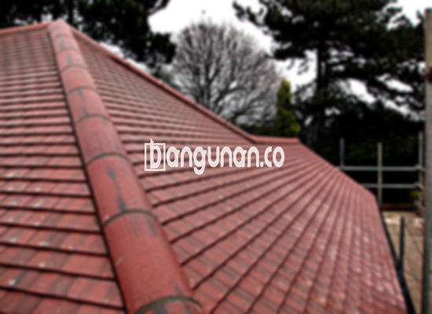

**Jual Genteng Kermaik & Beton di Kramat Jakarta** – Genteng adalah salah satu material bangunan yang sangat penting untuk dimiliki setiap pemilik rumah. Genteng berperan penting dalam melindungi hunian Anda dari berbagai kondisi cuaca seperti hujan, panas terik matahari, dan elemen alam lainnya. Dengan genteng yang tepat, rumah Anda akan terasa lebih aman dan nyaman. Bagi Mitra Bangunan yang mencari solusi atap berkualitas di Kramat Jakarta, kami hadir untuk memenuhi kebutuhan Anda.

Memilih genteng yang tepat merupakan investasi jangka panjang untuk keamanan dan kenyamanan rumah Anda. Pertimbangkan berbagai pilihan yang tersedia dengan cermat, karena setiap jenis genteng memiliki kelebihan dan kekurangan masing-masing. Memilih genteng yang berkualitas akan menghemat biaya perawatan di masa depan.



## Harga Genteng dari Toko Jual Genteng Kermaik & Beton di Kramat Jakarta

Kami menyediakan berbagai macam genteng dengan harga yang kompetitif. Setiap jenis genteng yang kami jual memiliki keunggulan tersendiri, dan pilihan harga yang bervariasi memudahkan Anda menentukan yang paling sesuai dengan anggaran. Apabila Anda membutuhkan referensi, berikut ini adalah informasi harga untuk beberapa jenis genteng yang populer di pasaran Kramat Jakarta:

### \- Harga Genteng Metal di Toko Genteng Kermaik & Beton di Kramat Jakarta

Salah satu pilihan genteng yang banyak diminati adalah genteng metal. Ringan, kuat, dan mudah dipasang, genteng metal menjadi solusi ideal untuk berbagai jenis bangunan, termasuk rumah modern minimalis. Anda bisa menemukan berbagai pilihan warna dan desain yang menarik. Detail harga genteng metal terbaru bisa Anda temukan pada tabel harga yang tersedia.

### \- Harga Genteng Aspal di Toko Genteng Kermaik & Beton di Kramat Jakarta

Genteng aspal menawarkan tampilan yang elegan dan menyerupai sirap kayu alami. Material ini tahan lama, tahan api, dan memberikan isolasi yang baik. Pilihan warna dan tekstur yang beragam memungkinkan Anda menciptakan tampilan atap yang unik dan sesuai dengan gaya arsitektur rumah Anda. Untuk mengetahui harga terkini, silakan lihat tabel harga kami.

### \- Harga Genteng Kermaik & Beton di Kramat Jakarta

Genteng keramik dan beton merupakan pilihan klasik yang populer di Indonesia. Keduanya dikenal karena kekuatan, daya tahan, dan variasi desain yang luas. Pilihan warna dan bentuk yang beragam memungkinkan Anda menciptakan tampilan atap yang unik dan menarik. Detail harga genteng keramik dan beton tersedia pada tabel harga di situs kami.

### \- Harga Genteng Kaca di Toko Genteng Kermaik & Beton di Kramat Jakarta

Genteng kaca sering digunakan sebagai aksen dekoratif untuk menciptakan efek pencahayaan alami di dalam ruangan. Biasanya dipasang pada area tertentu di atap untuk memberikan sentuhan estetik yang unik. Namun, perlu diingat bahwa genteng kaca kurang cocok digunakan sebagai penutup atap utama karena dapat meningkatkan suhu ruangan. Anda dapat melihat informasi harga pada tabel harga kami.

### \- Harga Genteng Seng di Toko Genteng Kermaik & Beton di Kramat Jakarta

Genteng seng merupakan pilihan ekonomis yang sering digunakan pada bangunan sederhana atau sebagai solusi sementara. Ringan dan mudah dipasang, genteng seng menjadi pilihan praktis bagi Anda yang memiliki anggaran terbatas. Perlu diingat bahwa genteng seng memerlukan perawatan rutin untuk mencegah karat. Informasi harga lengkap tersedia di tabel harga kami.

### \- Harga Genteng Beton di Toko Genteng Kermaik & Beton di Kramat Jakarta

Genteng beton dikenal karena kekuatannya, daya tahannya, dan perawatan yang minimal. Terbuat dari campuran semen, pasir, dan air, genteng beton memiliki umur pakai yang panjang dan tahan terhadap cuaca ekstrem. Anda dapat memilih dari berbagai pilihan warna dan finishing untuk menyesuaikan dengan gaya bangunan Anda. Silakan lihat tabel harga untuk mengetahui detail harga genteng beton.



## Beberapa Macam Genteng dari Toko Jual Genteng Kermaik & Beton di Kramat Jakarta

Kami menyediakan berbagai pilihan jenis genteng untuk memenuhi kebutuhan spesifik Anda. Berikut adalah beberapa jenis genteng yang tersedia di toko kami di Kramat Jakarta:

### Genteng Keramik dari Toko Jual Genteng Kermaik & Beton di Kramat Jakarta

Genteng keramik merupakan pilihan yang tepat untuk Anda yang menginginkan tampilan klasik dan elegan pada atap rumah Anda. Dengan berbagai pilihan warna dan tekstur, Anda dapat menciptakan tampilan atap yang unik dan menarik. Genteng keramik juga memberikan perlindungan yang baik terhadap cuaca dan api, sehingga Anda dapat merasa nyaman dan aman di dalam rumah Anda.

### Genteng Seng dan Genteng Kermaik & Beton di Kramat Jakarta

Genteng seng adalah pilihan yang ekonomis dan praktis untuk Anda yang mencari solusi atap yang terjangkau. Dengan ukurannya yang panjang, genteng seng memungkinkan pemasangan yang lebih efisien dan mengurangi limbah material. Agar lebih tahan lama, pastikan untuk memasang paku dengan kuat saat pemasangan. Anda bisa menemukan opsi serupa di [Jual Genteng Kermaik & Beton di Bangka Jakarta](/jual-genteng-kermaik-beton-di-bangka-jakarta/).

### Genteng Asbes dan Genteng Kermaik & Beton di Kramat Jakarta

Meskipun dulu populer, penggunaan genteng asbes kini tidak lagi disarankan karena mengandung serat asbes yang berpotensi membahayakan kesehatan. Kami tidak menyediakan genteng asbes dan merekomendasikan Anda untuk memilih alternatif yang lebih aman dan ramah lingkungan.

### Genteng Kanopi Baja Ringan dan Genteng Kermaik & Beton di Kramat Jakarta

Genteng kanopi baja ringan menawarkan kombinasi antara kekuatan, ringan, dan estetika modern. Material ini populer digunakan pada bangunan komersial dan residensial karena mudah dipasang dan tahan lama terhadap berbagai kondisi cuaca. Pilihan warna dan profil yang beragam memungkinkan Anda menyesuaikannya dengan desain bangunan Anda.

### Genteng Sirap Kayu Ulin dan Genteng Kermaik & Beton di Kramat Jakarta

Genteng sirap kayu ulin memberikan tampilan alami dan estetika tradisional pada bangunan Anda. Terbuat dari kayu ulin yang tahan terhadap cuaca dan hama, genteng ini menawarkan keindahan dan daya tahan yang optimal. Anda dapat dengan mudah menemukan jenis genteng yang sesuai dengan preferensi Anda.

Anda dapat menemukan Genteng Kermaik & Beton di Kramat Jakarta yang paling ideal untuk rumah atau bangunan Anda. Untuk mendapatkan informasi lebih lanjut mengenai produk dan penawaran menarik, jangan ragu untuk menghubungi kami. Mitra Bangunan yang sedang mencari solusi atap terbaik, hubungi kami sekarang juga melalui tombol WhatsApp atau Telepon di halaman ini untuk mendapatkan penawaran harga terbaik!

**Ref by:**  [Genteng Kermaik & Beton  Kramat Jakarta](https://id.wikipedia.org/wiki/Genteng)