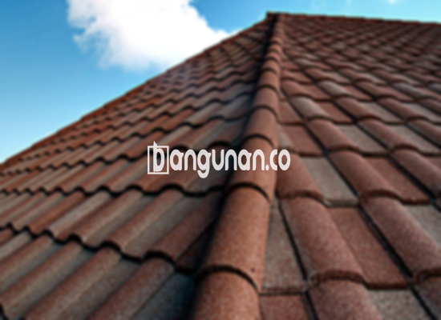

**Jual Genteng Kermaik & Beton di Kramat jati Jakarta** – Genteng merupakan bagian material tempat tinggal yang sangat penting untuk dimiliki setiap pemilik rumah. Genteng akan memberikan perlindungan optimal bagi hunian Anda dari berbagai kondisi cuaca seperti hujan deras, panas terik matahari, dan lainnya. Investasi pada genteng yang berkualitas akan menjadikan kondisi tempat tinggal terasa lebih aman dan nyaman bagi Mitra Bangunan.

Mempertimbangkan jenis genteng yang paling sesuai untuk kebutuhan rumah Anda merupakan langkah penting dalam proses pembangunan atau renovasi. Tersedia beragam pilihan genteng di pasaran, masing-masing menawarkan karakteristik dan keunggulan tersendiri. Penting bagi Anda untuk mengevaluasi faktor-faktor seperti iklim setempat, gaya arsitektur rumah, serta anggaran yang tersedia sebelum membuat keputusan akhir.



## Harga Genteng Dari Toko Jual Genteng Kermaik & Beton di Kramat jati Jakarta

Ketersediaan berbagai macam genteng memberikan Anda fleksibilitas dalam memilih material atap yang paling sesuai. Setiap jenis genteng tentu memiliki kelebihan yang unik. Berikut adalah perkiraan harga beberapa jenis genteng yang umum ditemui, sebagai referensi bagi Anda dalam merencanakan anggaran. Untuk informasi harga yang lebih akurat dan terkini, silakan merujuk ke tabel harga yang kami sediakan atau hubungi tim Kami.

### \- Harga Genteng Metal Di Toko Genteng Kermaik & Beton di Kramat jati Jakarta

Pilihan yang sangat diminati oleh banyak orang adalah genteng metal, yang dikenal karena ringan, tahan lama, dan mudah dalam proses pemasangannya. Jenis genteng ini seringkali menjadi pilihan ideal untuk bangunan dengan gaya modern dan minimalis. Tampilannya yang elegan dan kontemporer memberikan kesan aesthetic yang menarik.

### \- Harga Genteng Aspal Di Toko Genteng Kermaik & Beton di Kramat jati Jakarta

Genteng aspal merupakan pilihan yang juga populer, dikenal karena kemampuannya dalam menahan berbagai kondisi cuaca ekstrem dan meredam suara bising. Terbuat dari kombinasi serat kayu dan aspal berkualitas, material ini menawarkan fleksibilitas dan kekuatan yang mumpuni. Sifat tahan apinya juga menjadikannya pilihan yang aman dan andal.

### \- Harga Genteng Kermaik & Beton di Kramat jati Jakarta

Genteng keramik dan beton adalah pilihan klasik yang telah lama menjadi favorit di Indonesia. Kedua jenis genteng ini menawarkan nilai estetika yang tinggi dan memiliki ketahanan terhadap berbagai cuaca. Dengan beragam pilihan warna dan desain, Anda dapat menyesuaikan genteng dengan gaya arsitektur rumah Anda.

### \- Harga Genteng Kaca Di Toko Genteng Kermaik & Beton di Kramat jati Jakarta

Genteng kaca umumnya digunakan sebagai sentuhan dekoratif yang memberikan pencahayaan alami pada ruangan. Meskipun tidak direkomendasikan sebagai atap utama karena berpotensi meningkatkan suhu ruangan, genteng kaca dapat menciptakan tampilan yang unik dan menarik secara visual.

### \- Harga Genteng Seng Di Toko Genteng Kermaik & Beton di Kramat jati Jakarta

Genteng seng merupakan solusi ekonomis yang sering digunakan pada bangunan tradisional atau rumah dengan anggaran terbatas. Meskipun memiliki bobot yang ringan dan mudah dipasang, genteng seng cenderung memiliki umur pakai yang lebih pendek dibandingkan jenis genteng lainnya.

### \- Harga Genteng Beton Di Toko Genteng Kermaik & Beton di Kramat jati Jakarta

Genteng beton merupakan pilihan yang kokoh dan tahan lama, terbuat dari campuran semen, pasir, dan air berkualitas tinggi. Jenis genteng ini mampu menahan beban berat dan memberikan perlindungan optimal terhadap cuaca buruk. Banyak orang memilih genteng beton karena keawetannya dan minimnya perawatan yang dibutuhkan.



## Beberapa Variasi Genteng Dari Toko Jual Genteng Kermaik & Beton di Kramat jati Jakarta

Selain jenis-jenis genteng yang telah disebutkan, masih ada berbagai variasi lain yang dapat Anda pertimbangkan untuk melengkapi proyek pembangunan rumah Anda. Berikut adalah beberapa contoh variasi genteng yang tersedia:

### Genteng Keramik Dari Toko Jual Genteng Kermaik & Beton di Kramat jati Jakarta

Bagi Anda yang menginginkan tampilan klasik dan indah, genteng keramik menjadi alternatif yang sangat tepat. Jenis genteng ini menawarkan daya tarik visual tersendiri, sehingga rumah Anda akan terlihat lebih menarik dan elegan. Genteng keramik juga efektif dalam menjaga rumah dari panas matahari.

### Genteng Seng dan Genteng Kermaik & Beton di Kramat jati Jakarta

Genteng seng, sebagai pilihan yang telah lama dikenal, masih menjadi opsi yang relevan, terutama bagi mereka yang mencari solusi hemat biaya. Meskipun memerlukan perawatan ekstra, Anda dapat mengandalkan genteng seng untuk memenuhi kebutuhan atap Anda dengan anggaran terbatas.

### Genteng Asbes dan Genteng Kermaik & Beton di Kramat jati Jakarta

Genteng asbes, meskipun dulunya populer, kini semakin ditinggalkan karena isu kesehatan dan dampaknya terhadap lingkungan. Jika Anda mempertimbangkan penggunaan genteng asbes, Kami sarankan untuk mempertimbangkan opsi lain yang lebih aman dan ramah lingkungan.

### Genteng Kanopi Baja Ringan dan Genteng Kermaik & Beton di Kramat jati Jakarta

Genteng kanopi baja ringan menawarkan kombinasi unik antara kekuatan, ringan, dan tampilan modern. Baja ringan yang digunakan tahan terhadap karat dan memiliki daya tahan yang tinggi untuk berbagai jenis atap. Pemasangan dan perawatannya pun relatif mudah.

### Genteng Sirap Kayu Ulin dan Genteng Kermaik & Beton di Kramat jati Jakarta

Genteng sirap kayu ulin memberikan sentuhan alami dan unik pada desain rumah Anda. Terbuat dari kayu ulin yang dikenal tahan terhadap cuaca dan hama, jenis genteng ini menawarkan solusi yang estetis dan berkelanjutan. [Jual Genteng Kermaik & Beton di Kramat Jakarta](/jual-genteng-kermaik-beton-di-kramat-jakarta/) menyediakan pilihan genteng sirap kayu ulin berkualitas.

Anda dapat menemukan berbagai pilihan Genteng Kermaik & Beton di Kramat jati Jakarta yang sesuai dengan kebutuhan dan preferensi Anda. Tentukan jumlah, material genteng, dan jenis genteng yang Anda butuhkan. Jangan ragu untuk menghubungi Kami melalui tombol WhatsApp atau Telepon di halaman ini untuk mendapatkan penawaran harga terbaik dan pelayanan yang memuaskan. Kami di sini untuk membantu Mitra Bangunan mewujudkan atap impian Anda.

**Ref by:**  [Genteng Kermaik & Beton  Kramat jati Jakarta](https://id.wikipedia.org/wiki/Genteng)