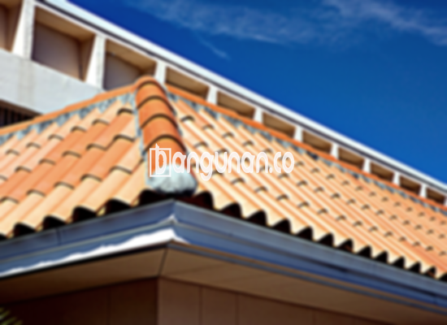

**Jual Genteng Kermaik & Beton di KramatPela Jakarta** – Genteng adalah material esensial bagi setiap pemilik hunian, memberikan perlindungan yang krusial dari berbagai kondisi cuaca. Bagi Mitra Bangunan di KramatPela Jakarta, menemukan solusi atap yang tepat kini menjadi lebih mudah. Kami menyediakan beragam pilihan genteng berkualitas yang dirancang untuk memenuhi kebutuhan dan anggaran Anda, memastikan rumah Anda terlindungi dengan sempurna selama bertahun-tahun.

Memastikan kualitas atap rumah Anda sangatlah penting, karena atap yang baik akan memberikan kenyamanan dan keamanan maksimal. Banyaknya pilihan genteng yang tersedia di pasaran kadang membingungkan, namun dengan memahami keunggulan dan kekurangan masing-masing jenis, Anda dapat membuat keputusan yang tepat. Pertimbangkan gaya arsitektur rumah Anda dan alokasi anggaran untuk mendapatkan hasil yang optimal.



## Informasi Harga Genteng dari Toko Jual Genteng Kermaik & Beton di KramatPela Jakarta

Ada banyak sekali variasi harga genteng yang perlu Anda ketahui sebelum berbelanja. Setiap jenis genteng menawarkan nilai yang berbeda, dan memahami kisaran harga akan membantu Anda membuat keputusan yang lebih cerdas. Berikut adalah panduan harga beberapa jenis genteng yang bisa Anda pertimbangkan:

### Harga Genteng Metal di Toko Genteng Kermaik & Beton di KramatPela Jakarta

Genteng metal merupakan solusi modern yang populer, terutama untuk desain rumah minimalis. Dengan tampilan yang ringkas dan elegan, genteng ini menawarkan kemudahan pemasangan yang signifikan. Genteng metal juga dikenal karena kekuatannya dan kemampuannya menahan berbagai kondisi cuaca. Harga genteng metal terbaru adalah Rp. 26.000 per pcs.

### Harga Genteng Aspal di Toko Genteng Kermaik & Beton di KramatPela Jakarta

Genteng aspal dikenal karena sifatnya yang tahan lama dan kemampuan meredam suara. Terbuat dari kombinasi serat kayu dan aspal, material ini memberikan keseimbangan ideal antara kekuatan dan fleksibilitas. Selain itu, genteng aspal memiliki ketahanan api yang baik, memberikan lapisan keamanan tambahan untuk rumah Anda. Harga genteng aspal terbaru adalah Rp.125.000 per m2.

### Harga Genteng Kermaik & Beton di KramatPela Jakarta

Genteng keramik dan beton adalah pilihan klasik yang terus digemari karena keindahan dan daya tahannya. Kedua jenis ini tersedia dalam berbagai warna dan desain, memungkinkan Anda menciptakan tampilan atap yang unik dan sesuai dengan gaya rumah Anda. Investasi dalam genteng keramik atau beton adalah investasi jangka panjang untuk keamanan dan estetika rumah Anda. Harga genteng keramik terbaru adalah Rp. 9.800 per buah.

### Harga Genteng Kaca di Toko Genteng Kermaik & Beton di KramatPela Jakarta

Genteng kaca umumnya digunakan sebagai elemen dekoratif untuk memberikan sentuhan unik pada atap. Penggunaannya lebih sering sebagai aksen, karena sifatnya yang menghantarkan panas dapat meningkatkan suhu ruangan. Namun, jika Anda menginginkan pencahayaan alami yang lebih baik, genteng kaca bisa menjadi pilihan yang menarik. Harga genteng kaca seakrang ialah Rp. 8.800 per biji.

### Harga Genteng Seng di Toko Genteng Kermaik & Beton di KramatPela Jakarta

Genteng seng adalah pilihan ekonomis yang sering digunakan pada bangunan tradisional. Bentuknya yang panjang dan ringan membuatnya mudah dipasang dan mengurangi beban pada struktur atap. Namun, perlu diingat bahwa genteng seng mungkin memerlukan perawatan yang lebih sering untuk mencegah karat dan kerusakan. Harga genteng seng saat ini yakni Rp. 39.000 per buah.

### Harga Genteng Beton di Toko Genteng Kermaik & Beton di KramatPela Jakarta

Genteng beton adalah pilihan yang sangat kokoh dan tahan lama, ideal untuk iklim tropis seperti di Indonesia. Terbuat dari campuran semen, pasir, dan air, genteng ini mampu menahan beban berat dan kondisi cuaca ekstrem. Banyak orang memilih genteng beton karena ketahanannya dan umur pakainya yang panjang. Harga genteng beton saat ini adalah Rp. 5.800 per biji.



## Ragam Jenis Genteng dari Toko Jual Genteng Kermaik & Beton di KramatPela Jakarta

Kami menawarkan berbagai pilihan jenis genteng untuk memenuhi kebutuhan dan preferensi Anda. Dengan memahami karakteristik masing-masing jenis, Anda dapat memilih yang paling sesuai untuk rumah Anda di KramatPela Jakarta:

### Genteng Keramik dari Toko Jual Genteng Kermaik & Beton di KramatPela Jakarta

Jika Anda mencari tampilan yang klasik dan elegan, genteng keramik adalah pilihan yang tepat. Genteng ini memberikan nilai estetika yang tinggi dan membantu menjaga suhu ruangan tetap nyaman dengan sifatnya yang mampu meredam panas. Anda akan merasakan perbedaan signifikan dalam kenyamanan rumah Anda dengan genteng keramik.

### Genteng Seng dan Genteng Kermaik & Beton di KramatPela Jakarta

Genteng seng adalah pilihan yang ekonomis, sering digunakan pada bangunan-bangunan yang sudah ada. Meskipun demikian, dengan perawatan yang tepat, genteng seng dapat memberikan perlindungan yang memadai terhadap cuaca. Pastikan pemasangan dilakukan dengan benar dan menggunakan paku yang kuat untuk mencegah genteng bergeser.

### Genteng Asbes dan Genteng Kermaik & Beton di KramatPela Jakarta

Meskipun dulunya populer, genteng asbes kini mulai ditinggalkan karena pertimbangan kesehatan dan lingkungan. Genteng asbes memiliki potensi untuk melepaskan serat berbahaya, sehingga sebaiknya dihindari. Pilihlah alternatif yang lebih sehat dan ramah lingkungan untuk keluarga Anda.

### Genteng Kanopi Baja Ringan dan Genteng Kermaik & Beton di KramatPela Jakarta

Genteng kanopi baja ringan menjadi pilihan yang semakin populer karena ringan, kuat, dan mudah dipasang. Material ini memberikan kombinasi yang ideal antara kekuatan dan kemudahan pemasangan, serta tersedia dalam berbagai desain modern. Dengan genteng kanopi baja ringan, Anda dapat menikmati atap yang tahan lama dan estetis.

### Genteng Sirap Kayu Ulin dan Genteng Kermaik & Beton di KramatPela Jakarta

Genteng sirap kayu ulin memberikan sentuhan alami dan tradisional pada rumah Anda. Terbuat dari kayu ulin yang tahan lama, genteng ini memberikan tampilan yang unik dan elegan. Meskipun membutuhkan perawatan yang lebih intensif, genteng sirap kayu ulin dapat menciptakan suasana yang hangat dan nyaman di rumah Anda.

Anda, sebagai Mitra Bangunan, dapat menemukan berbagai pilihan genteng berkualitas tinggi di toko kami di KramatPela Jakarta. Jangan ragu untuk berkonsultasi dengan tim kami untuk mendapatkan rekomendasi yang sesuai dengan kebutuhan dan anggaran Anda. Hubungi kami sekarang juga untuk mendapatkan penawaran terbaik dan layanan yang memuaskan.

**Ref by:**  [Genteng Kermaik & Beton  KramatPela Jakarta](https://id.wikipedia.org/wiki/Genteng)