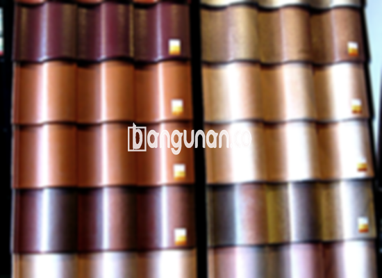

**Jual Genteng Kermaik & Beton di Krendang Jakarta** – Membangun atau merenovasi rumah di Krendang Jakarta memerlukan material berkualitas, dan genteng adalah salah satu yang paling utama. Genteng melindungi hunian Anda dari cuaca ekstrem, sekaligus menentukan estetika rumah. Mitra Bangunan menyediakan beragam pilihan genteng untuk memenuhi kebutuhan proyek Anda. Dengan pengiriman gratis ongkir dan opsi pembayaran COD, kami hadir sebagai solusi praktis untuk kebutuhan bangunan Anda.

Ada berbagai jenis genteng yang bisa Anda pertimbangkan, masing-masing dengan keunggulan dan kekurangannya sendiri. Memilih genteng yang tepat akan memastikan kenyamanan dan keamanan rumah Anda selama bertahun-tahun. Setiap orang memiliki preferensi tersendiri, dan kami siap membantu Anda menemukan genteng impian.



## Harga Genteng dari Toko Jual Genteng Kermaik & Beton di Krendang Jakarta

Kini, Anda dapat menemukan beragam opsi genteng dengan harga yang bervariasi. Berikut adalah gambaran umum harga beberapa jenis genteng yang tersedia di Krendang Jakarta:

### - Harga Genteng Metal di Toko Genteng Kermaik & Beton di Krendang Jakarta

Genteng metal adalah pilihan populer karena kekuatannya dan tampilan modernnya. Banyak yang memilih genteng ini untuk rumah minimalis. Dengan desain yang menarik, genteng metal dapat meningkatkan estetika bangunan Anda. Untuk informasi harga lebih detail, silakan hubungi kami.

### - Harga Genteng Aspal di Toko Genteng Kermaik & Beton di Krendang Jakarta

Genteng aspal terbuat dari serat kayu dan aspal, menawarkan kombinasi kekuatan dan fleksibilitas. Bahan ini tahan terhadap api dan memberikan perlindungan yang baik terhadap cuaca. Untuk mengetahui harga terbaru, Anda dapat merujuk ke tabel harga kami atau menghubungi tim penjualan.

### - Harga Genteng Kermaik & Beton di Krendang Jakarta

Genteng keramik dikenal dengan keindahan dan daya tahannya. Pilihan warna yang beragam memungkinkan Anda menyesuaikan tampilan rumah sesuai selera. Kami menyediakan berbagai pilihan genteng keramik berkualitas tinggi. Dapatkan informasi harga selengkapnya melalui layanan pelanggan kami.

### - Harga Genteng Kaca di Toko Genteng Kermaik & Beton di Krendang Jakarta

Genteng kaca sering digunakan sebagai aksen untuk memberikan pencahayaan alami pada ruangan. Penggunaannya tidak terlalu luas karena dapat meningkatkan suhu ruangan. Namun, sebagai elemen dekoratif, genteng kaca dapat memberikan sentuhan unik pada desain rumah Anda.

### - Harga Genteng Seng di Toko Genteng Kermaik & Beton di Krendang Jakarta

Genteng seng merupakan pilihan ekonomis yang sering digunakan untuk rumah-rumah tradisional. Ukurannya yang panjang membuat pemasangan lebih efisien. Untuk memastikan kekuatan dan keamanan, gunakan paku yang berkualitas saat pemasangan. Detail harga tersedia di tabel harga atau melalui kontak layanan pelanggan.

### - Harga Genteng Beton di Toko Genteng Kermaik & Beton di Krendang Jakarta

Genteng beton terbuat dari campuran semen, pasir, dan air, menjadikannya sangat kuat dan tahan lama. Banyak orang memilih genteng beton karena kualitas dan kehandalannya. Dapatkan informasi harga genteng beton terkini dengan menghubungi kami.



## Beberapa Variasi Genteng dari Toko Jual Genteng Kermaik & Beton di Krendang Jakarta

Berikut adalah berbagai jenis genteng yang tersedia untuk bangunan rumah Anda di Krendang Jakarta:

### Genteng Keramik dari Toko Jual Genteng Kermaik & Beton di Krendang Jakarta

Genteng keramik adalah pilihan ideal bagi Anda yang mencari kombinasi keindahan dan fungsi. Dengan berbagai pilihan warna dan desain, genteng ini dapat meningkatkan estetika rumah Anda secara signifikan. Selain itu, genteng keramik mampu melindungi rumah Anda dari panas matahari.

### Genteng Seng dan Genteng Kermaik & Beton di Krendang Jakarta

Genteng seng, dengan bentuknya yang panjang, merupakan opsi ekonomis yang sering digunakan pada bangunan tradisional. Pemasangan yang kuat dapat dicapai dengan menggunakan paku berkualitas tinggi. Kami menyediakan berbagai pilihan untuk kebutuhan Anda.

### Genteng Asbes dan Genteng Kermaik & Beton di Krendang Jakarta

Genteng asbes, meskipun pernah populer, memiliki kekurangan dalam hal daya tahan. Bahan ini cenderung mudah rusak dan memerlukan penggantian. Pertimbangkan alternatif yang lebih tahan lama untuk investasi jangka panjang.

### Genteng Kanopi Baja Ringan dan Genteng Kermaik & Beton di Krendang Jakarta

Genteng kanopi baja ringan menawarkan kombinasi antara kekuatan, ringan, dan estetika modern. Genteng ini sangat cocok untuk berbagai desain atap dan memberikan perlindungan yang optimal.

### Genteng Sirap Kayu Ulin dan Genteng Kermaik & Beton di Krendang Jakarta

Genteng sirap kayu ulin terbuat dari kayu ulin yang kuat dan tahan lama. Bentuknya yang unik memberikan tampilan alami pada rumah Anda. Dengan harga yang terjangkau, genteng ini menjadi pilihan menarik bagi Anda yang menginginkan sentuhan tradisional.

Anda dapat memperoleh Genteng Kermaik & Beton di Krendang Jakarta yang sesuai dengan kebutuhan Anda. Tentukan jumlah, material, dan jenis genteng yang diperlukan, lalu hubungi kami untuk mendapatkan penawaran terbaik. Kami siap membantu Anda menemukan solusi yang tepat untuk proyek bangunan Anda. Mitra Bangunan siap melayani Anda, hubungi kami melalui tombol WhatsApp atau Telepon di halaman ini untuk informasi lebih lanjut.

**Ref by:**  [Genteng Kermaik & Beton  Krendang Jakarta](https://id.wikipedia.org/wiki/Genteng)