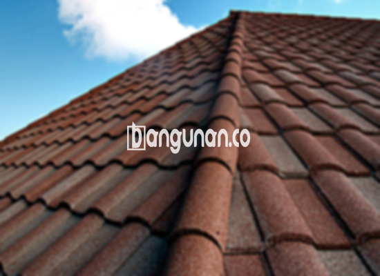

**Jual Genteng Kermaik & Beton di Kresek Tangerang** – Genteng merupakan material penting untuk setiap hunian, dan Mitra Bangunan di Kresek Tangerang hadir untuk memenuhi kebutuhan Anda. Hunian yang terlindungi dengan baik dari berbagai kondisi cuaca seperti hujan dan panas terik memerlukan genteng yang berkualitas. Dengan memilih genteng yang tepat, Anda akan menciptakan lingkungan tinggal yang lebih nyaman dan aman.

Memilih genteng yang sesuai adalah langkah krusial dalam pembangunan atau renovasi rumah. Ada beragam jenis genteng yang tersedia di pasaran, masing-masing dengan kelebihan dan kekurangan tersendiri. Pertimbangkan gaya arsitektur rumah Anda, anggaran yang tersedia, serta iklim di Kresek Tangerang saat memilih jenis genteng yang paling tepat. Investasi pada genteng berkualitas akan memberikan perlindungan jangka panjang bagi properti Anda.



## Harga Genteng dari Toko Jual Genteng Kermaik & Beton di Kresek Tangerang

Kami menyediakan beragam pilihan genteng dengan harga yang kompetitif di Kresek Tangerang. Berikut adalah gambaran mengenai beberapa jenis genteng yang tersedia beserta perkiraan harganya. Penting untuk diingat bahwa harga dapat bervariasi tergantung pada merek, ukuran, dan spesifikasi produk.

### - Harga Genteng Metal di Toko Genteng Kermaik & Beton di Kresek Tangerang

Genteng metal adalah pilihan yang populer karena ringan, kuat, dan tahan lama. Biasanya diterapkan pada rumah bergaya minimalis, genteng metal memberikan kesan elegan dan modern. Pilihan warna dan profil yang beragam memungkinkan Anda untuk menyesuaikan genteng dengan desain rumah Anda.

### - Harga Genteng Aspal di Toko Genteng Kermaik & Beton di Kresek Tangerang

Genteng aspal menawarkan tampilan mewah dan klasik. Terbuat dari serat kayu dan aspal, material ini memiliki karakteristik kedap suara dan tahan terhadap api. Genteng aspal seringkali menjadi pilihan bagi mereka yang mencari estetika tradisional dengan perlindungan optimal.

### - Harga Genteng Kermaik & Beton di Kresek Tangerang

Genteng keramik dan beton adalah pilihan yang banyak digunakan di Indonesia karena daya tahannya dan kemampuannya menahan berbagai kondisi cuaca. Keduanya tersedia dalam beragam warna dan bentuk, memungkinkan Anda menciptakan tampilan hunian yang unik dan personal. Genteng keramik memberikan kesan tradisional sedangkan genteng beton menawarkan estetika modern yang kokoh.

### - Harga Genteng Kaca di Toko Genteng Kermaik & Beton di Kresek Tangerang

Genteng kaca biasanya digunakan sebagai aksen dekoratif untuk memberikan pencahayaan alami pada ruangan di bawahnya. Walaupun jarang dijadikan penutup atap utama, genteng kaca dapat menciptakan efek visual yang menarik dan meningkatkan estetika rumah Anda. Perencanaan yang tepat diperlukan untuk menghindari panas berlebih yang mungkin ditimbulkan.

### - Harga Genteng Seng di Toko Genteng Kermaik & Beton di Kresek Tangerang

Genteng seng menjadi pilihan yang ekonomis, terutama untuk bangunan sederhana atau proyek dengan anggaran terbatas. Material ini ringan, mudah dipasang, dan relatif tahan terhadap korosi. Namun, perlu diperhatikan bahwa genteng seng cenderung lebih berisik saat terkena hujan.

### - Harga Genteng Beton di Toko Genteng Kermaik & Beton di Kresek Tangerang

Genteng beton dikenal karena kekuatannya dan kemampuannya menahan beban. Terbuat dari campuran semen, pasir, dan air, material ini sangat tahan terhadap cuaca ekstrem dan memiliki umur pakai yang panjang. Kami menawarkan berbagai pilihan ukuran dan bentuk genteng beton untuk memenuhi kebutuhan spesifik proyek Anda.



## Beberapa Macam Genteng dari Toko Jual Genteng Kermaik & Beton di Kresek Tangerang

Berikut adalah beberapa jenis genteng yang populer dan sering digunakan oleh pelanggan kami di Kresek Tangerang:

### Genteng Keramik dari Toko Jual Genteng Kermaik & Beton di Kresek Tangerang

Bagi Anda yang sedang mencari genteng untuk rumah impian, genteng keramik merupakan pilihan yang sangat ideal. Material ini menawarkan kombinasi antara keindahan, ketahanan, dan kemudahan perawatan. Anda akan merasakan efisiensi energi yang lebih baik karena genteng keramik membantu menjaga suhu ruangan tetap stabil.

### Genteng Seng dan Genteng Kermaik & Beton di Kresek Tangerang

Genteng seng, yang sering digunakan pada bangunan-bangunan lama, masih menjadi pilihan praktis bagi sebagian orang. Ukurannya yang panjang seringkali membuatnya lebih hemat biaya. Untuk pemasangan yang optimal, pastikan untuk menggunakan paku berkualitas tinggi agar genteng tetap kuat dan tahan lama.

### Genteng Asbes dan Genteng Kermaik & Beton di Kresek Tangerang

Genteng asbes adalah pilihan ekonomis, namun perlu diperhatikan bahwa material ini memiliki beberapa kekurangan. Genteng asbes cenderung mudah rusak dan kurang ramah lingkungan. Untuk investasi jangka panjang, kami menyarankan untuk mempertimbangkan alternatif lain yang lebih berkelanjutan.

### Genteng Kanopi Baja Ringan dan Genteng Kermaik & Beton di Kresek Tangerang

Genteng kanopi baja ringan adalah pilihan populer untuk bangunan-bangunan modern. Material ini ringan, kuat, tahan terhadap korosi, dan mudah dipasang. Tersedia dalam berbagai warna dan profil, sehingga dapat menyesuaikan dengan desain rumah Anda.

### Genteng Sirap Kayu Ulin dan Genteng Kermaik & Beton di Kresek Tangerang

Genteng sirap kayu ulin menawarkan tampilan yang unik dan alami. Terbuat dari kayu ulin yang tahan terhadap cuaca ekstrem, material ini memiliki masa pakai yang panjang dan memberikan kesan mewah pada hunian Anda. [Jual Genteng Kermaik & Beton di Batuceper Tangerang](/jual-genteng-kermaik-beton-di-batuceper-tangerang/) menampilkan inspirasi desain yang menarik untuk rumah Anda.

Anda dapat memilih jenis Genteng Kermaik & Beton di Kresek Tangerang yang paling sesuai dengan kebutuhan dan anggaran Anda. Jangan ragu untuk menghubungi tim kami untuk mendapatkan solusi terbaik guna mewujudkan atap rumah impian Anda. Mitra Bangunan siap membantu Anda dalam memilih dan memasang genteng berkualitas tinggi. Hubungi kami sekarang lewat tombol WhatsApp atau Telepon di halaman ini untuk mendapatkan penawaran istimewa!

**Ref by:**  [Genteng Kermaik & Beton  Kresek Tangerang](https://id.wikipedia.org/wiki/Genteng)