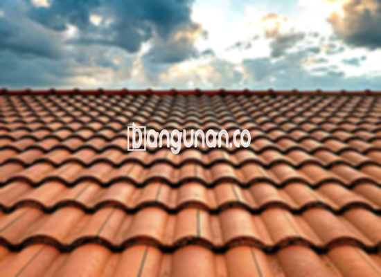

**Jual Genteng Kermaik & Beton di Kronjo Tangerang** – Genteng adalah material vital bagi setiap hunian, dan Mitra Bangunan di Kronjo Tangerang hadir untuk memenuhi kebutuhan tersebut. Melindungi rumah dari berbagai kondisi cuaca seperti hujan deras, sengatan matahari, dan lainnya, genteng sangat penting untuk menciptakan lingkungan hidup yang nyaman dan aman. Rumah tanpa genteng tentu akan terasa tidak nyaman dan rentan terhadap kerusakan.

Memilih genteng yang tepat membutuhkan pertimbangan matang. Ada berbagai jenis genteng yang tersedia, masing-masing dengan karakteristik dan keunggulannya sendiri. Setiap orang memiliki preferensi masing-masing, sehingga penting untuk menyesuaikan pilihan dengan desain rumah dan anggaran yang tersedia. Mengingat rumah adalah investasi jangka panjang, menggunakan genteng berkualitas adalah keputusan yang bijaksana.



## Harga Genteng dari Toko Jual Genteng Kermaik & Beton di Kronjo Tangerang

Tersedia beragam pilihan genteng yang dapat Anda pertimbangkan. Setiap jenis genteng tentunya memiliki keunggulan tersendiri. Berikut ini adalah perkiraan harga beberapa jenis genteng yang bisa Anda gunakan sebagai referensi. Kami sarankan untuk selalu memeriksa harga terkini karena dapat berubah sewaktu-waktu.

### – Harga Genteng Metal di Toko Genteng Kermaik & Beton di Kronjo Tangerang

Genteng metal menjadi pilihan populer karena ringan, kuat, dan mudah dipasang. Material ini sering digunakan pada desain rumah minimalis modern, memberikan tampilan yang bersih dan rapi. Genteng metal juga tersedia dalam berbagai pilihan warna.

### – Harga Genteng Aspal di Toko Genteng Kermaik & Beton di Kronjo Tangerang

Genteng aspal menawarkan alternatif yang menarik dengan tampilan yang elegan dan mewah. Dibuat dari serat kayu dan aspal berkualitas tinggi, genteng ini memiliki daya tahan yang baik terhadap cuaca ekstrem serta menawarkan isolasi termal yang efektif.

### – Harga Genteng Kermaik & Beton di Kronjo Tangerang

Genteng keramik dan beton adalah pilihan klasik yang menawarkan kombinasi antara kekuatan, daya tahan, dan estetika. Bahan ini hadir dalam berbagai bentuk, warna, dan tekstur, memungkinkan Anda menciptakan tampilan atap yang unik dan sesuai dengan gaya rumah Anda di Kronjo Tangerang.

### – Harga Genteng Kaca di Toko Genteng Kermaik & Beton di Kronjo Tangerang

Genteng kaca memberikan sentuhan modern dan elegan pada atap rumah Anda. Meskipun memberikan efek visual yang menarik, perlu diingat bahwa genteng kaca dapat meningkatkan suhu ruangan karena kemampuannya menghantarkan panas. Penggunaan genteng kaca biasanya sebagai aksen atau pelengkap.

### – Harga Genteng Seng di Toko Genteng Kermaik & Beton di Kronjo Tangerang

Genteng seng adalah pilihan ekonomis yang cocok untuk berbagai jenis bangunan. Meskipun relatif ringan dan mudah dipasang, material ini mungkin memerlukan perawatan berkala untuk mencegah karat dan kebocoran.

### – Harga Genteng Beton di Toko Genteng Kermaik & Beton di Kronjo Tangerang

Genteng beton dikenal dengan kekuatannya dan kemampuannya menahan beban. Terbuat dari campuran semen, pasir, dan air, genteng ini sangat cocok untuk iklim tropis seperti di Kronjo Tangerang karena tahan terhadap cuaca ekstrem dan memiliki umur pakai yang panjang.



## Beberapa Tipe Genteng dari Toko Jual Genteng Kermaik & Beton di Kronjo Tangerang

Berikut adalah beberapa jenis genteng yang bisa Anda pilih untuk membangun atau merenovasi rumah Anda di Kronjo Tangerang:

### Genteng Keramik dari Toko Jual Genteng Kermaik & Beton di Kronjo Tangerang

Jika Anda mencari genteng yang tahan lama dan memberikan tampilan yang indah, genteng keramik adalah pilihan yang sangat tepat. Anda dapat memilih berbagai warna dan desain untuk menciptakan tampilan atap yang sesuai dengan gaya rumah Anda.

### Genteng Seng dan Genteng Kermaik & Beton di Kronjo Tangerang

Genteng seng, meskipun sering dikaitkan dengan bangunan tradisional, masih menjadi pilihan populer karena harganya yang terjangkau dan kemudahan pemasangannya. Pastikan Anda memilih genteng seng yang dilapisi dengan cat anti-karat untuk memperpanjang umur pakainya.

### Genteng Asbes dan Genteng Kermaik & Beton di Kronjo Tangerang

Genteng asbes menawarkan alternatif yang ringan dan murah, namun perlu Anda pertimbangkan kekurangannya. Bahan ini cenderung kurang tahan lama dan dapat menimbulkan masalah kesehatan jika tidak ditangani dengan benar.

### Genteng Kanopi Baja Ringan dan Genteng Kermaik & Beton di Kronjo Tangerang

Genteng kanopi baja ringan merupakan pilihan modern yang menawarkan kekuatan, daya tahan, dan fleksibilitas. Material ini relatif ringan, mudah dipasang, dan tersedia dalam berbagai pilihan desain serta warna.

### Genteng Sirap Kayu Ulin dan Genteng Kermaik & Beton di Kronjo Tangerang

Genteng sirap kayu ulin memberikan tampilan alami dan unik pada atap rumah Anda. Dibuat dari kayu ulin berkualitas tinggi yang tahan terhadap cuaca ekstrem, genteng ini adalah pilihan yang ideal untuk menciptakan suasana rumah yang hangat dan nyaman.

Anda dapat menemukan berbagai macam Genteng Kermaik & Beton di Kronjo Tangerang sesuai dengan kebutuhan dan preferensi Anda. Kami siap membantu Anda dalam menentukan jenis, jumlah, dan material genteng yang paling sesuai. Jangan ragu untuk menghubungi kami untuk mendapatkan penawaran harga terbaik dan layanan konsultasi gratis. Mitra Bangunan siap menjadi partner terbaik dalam membangun impian Anda di Kronjo Tangerang.

**Ref by:**  [Genteng Kermaik & Beton  Kronjo Tangerang](https://id.wikipedia.org/wiki/Genteng)